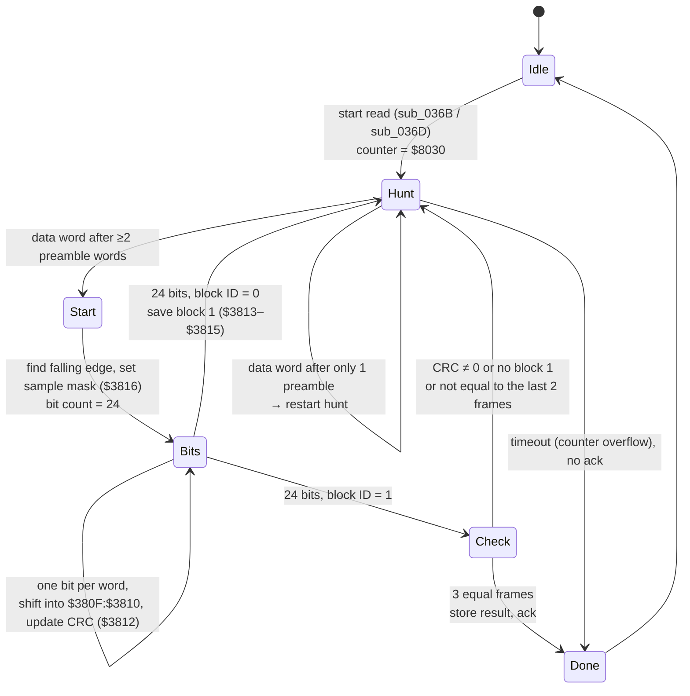

# Serial absolute-encoder link (DSP SPORT0) — frame format and result path

How the Control-board DSPs read the motors' serial absolute encoders, reconstructed from
the DSP firmware (page 1, `FW/SERVO_IO/1/U7_dis.asm`) and the SERVO firmware
(`ROM_SERVO.bin`). Context: `doc/control_board_firmware.md`, `doc/servo_dsp_link.md`.

Tags: **[C]** confirmed by code; **[I]** inferred, likely; **[H]** hypothesis.

---

## 1. Summary

- SPORT0 is **receive-only**. No code writes `TX0`. The DSP generates SCLK and the frame
  sync itself, so it just **samples the encoder data line** continuously: one 16-bit word
  per interrupt, back to back. [C]
- One **encoder bit = one SPORT word = 16 SCLK samples**; the DSP takes one sample per word
  at a fixed phase. [C]
- A **frame = two 24-bit blocks**. Each block has its own idle preamble and start sequence:
  1 unchecked start/frame bit, 1 checked spare bit, a **block-ID bit**, **16 data bits** and
  a **CRC-5, polynomial x⁵+x²+1**. [C]
- Block 1 = **status byte + position bits 23..16**. Block 2 = **position bits 15..0**. [C][I]
- A read is accepted only after **three consecutive identical frames**. [C]
- Result: **24-bit position → CXD8501R counter** (`$3026/$3027` motor A, `$302A/$302B`
  motor B), **status byte → `$3003`** (A low byte, B high byte), and a copy in DSP RAM
  `$38C5–$38C8`. Then the mailbox command is acknowledged. [C]
- The SERVO board reads the counters as a **signed 24-bit position** per axis. [C]

## 2. Who starts a read

All in the DSP's **IRQ2** path (`$01D0–$01F9`) and SPORT0 RX handler (vector `$000C`:
`AY0 = RX0; JUMP (DM[$38D2])`).

| Trigger | Command code | Effect |
|---|---|---|
| SERVO writes `$8082` / `$8084` to the mailbox (`$3000`) | stored in `$38CF` and `$38D0` | **ABSCOPY**: read encoder of motor A / B, load the CXD8501R counter, **ack** (`$3000 = 0`) when done [C] |
| DSP itself, every `$400` IRQ2 ticks, alternating A/B (countdown `$38C4` from `$2000`) | `$8092` / `$8094` (`$38D0 = 0`) | **background status read**: updates `$3003` and `$38C5–$38C8`, does **not** touch the counters and does **not** ack [C] |

Starting a read (`$01EF–$01F7`): if the code differs from the one in progress (`$38CF`),
store it, then set **bit 0 of the output latch `$3200`** to 0 for motor A or 1 for motor B.
That is almost certainly the **multiplexer select** that routes motor A's or B's encoder
data to DR0. Then call `sub_036B`, which arms the receiver. [C][I]

Other `$3200` bits from the same code: bit 7 heartbeat, bit 6 set when FLAG_IN is low,
bits 2–5 copied from `$303F`. [C]

## 3. Receiver state machine

The state is the address in DM `$38D2`; each received word jumps there.



| State (`$38D2`) | Address | What it does |
|---|---|---|
| **Idle** | `$03EA` | `RTI` — ignore samples [C] |
| **Hunt** | `$0389` | A word whose top 12 bits are all 1 (`& $FFF0 == $FFF0`) is a **preamble** (line idle high). Counter `$380E` starts at `$8030` (negative). The first preamble sets it to 2, the next to 1. A non-preamble word with counter = 1 is the **start**. A non-preamble word with counter = 2 (only one preamble) restarts the hunt. While the counter is negative each non-preamble word decrements it; after 48 such words the overflow (AV) ends the read **without ack** (SERVO then times out) [C] |
| **Start** | `$0376` | Finds the start edge in the first data word and builds the **sample mask** `$3816`. If bit 15 = 1, it searches for the first 0 (falling edge at bit *k*) and samples **3 samples later**. If bit 15 = 0, it searches for the first 1 and samples **5 samples earlier**. Both land 3 samples after the falling edge if that first 1 is 8 samples after it, which fits a **half-bit of 8 samples** (Manchester-like coding). Clears the shift register and CRC; bit count `$3811 = 24` [C][I] |
| **Bits** | `$039A` | Per word: `bit = (word & mask) ≠ 0`. Shift into the 32-bit register `$380F:$3810` (MSB first, new bit at LSB). If the bit is 1, `CRC ^= T[count]` (table at DM `$381A + count − 1`). Count down; after 24 bits: block ID = bit 21 of the register [C] |
| **Check / store** | `$03B7–$03E9` | §5 |

## 4. Block format

Bits are numbered by the bit counter: **c = 24 is received first**, c = 1 last. After the
24 bits, received bit *c* is at bit *c − 1* of `$380F:$3810`. [C]

| c (order) | Field | Evidence |
|---|---|---|
| 24 | start/frame bit — **not covered by the CRC** (table entry 0) | `T[24] = 0` [C] |
| 23 | spare/flag bit — covered by the CRC, not used | `T[23] = $15`; dropped when only the low 16 data bits are kept [C] |
| 22 | **block ID**: 0 = block 1, 1 = block 2 | test `SR1 & $0020` [C] |
| 21 … 6 | **16 data bits**, MSB first | `>> 5`, keep SR0 [C] |
| 5 … 1 | **CRC-5** | `T[1..5] = 1, 2, 4, 8, $10` [C] |

**CRC.** The table `T` (copied by page 0 from PM `$0092`, 24 words) is
`T[c] = x^(c−1) mod g(x)` for c = 1..23 with **g(x) = x⁵ + x² + 1** (e.g. `T[6] = $05`,
`T[7] = $0A`, `T[9] = $0D`). A block is valid when the syndrome (XOR of `T[c]` over all
1-bits) is **0**: bits 23…6 followed by the 5 check bits form a codeword of this polynomial,
with zero initial value. This polynomial is the one used by USB's CRC-5. Bit order and
initial value differ from USB, so do not reuse a USB routine as is. [C]

```text
block on the wire (after ≥2 idle-high bit times and the start edge):
 c: 24   23   22    21 ...................... 6    5 ...... 1
   [S]  [F]  [ID]  [ D15 ..................... D0 ] [ CRC-5 ]
```

| Block | ID | D15..D8 | D7..D0 |
|---|---|---|---|
| 1 | 0 | **status byte** → `$3003` | **position bits 23..16** |
| 2 | 1 | **position bits 15..0** | |

Why this split: [C][I]

- Block 1's high byte goes to the status word `$3003`. The full block-1 word goes to
  CXD8501R `$3027` / `$302B`, and the SERVO reads that register as a **byte**
  (`ld.b`, sign-extended) and shifts it left by 16. Block 2 goes to `$3026` / `$302A`,
  which the SERVO reads as the low 16 bits.
- The stability check compares **all 16 bits of block 1** but only **bits 15..10 of block 2**
  with the previous two frames. Low position bits may jitter by a few counts; status and
  high position bits must not.

The meaning of the 8 status bits is not decoded yet. The SERVO error texts give the likely
contents: battery low, shock (over-speed while unpowered), UVW error. [H]

## 5. Accepting the result (`$03B7–$03E9`)

1. Block 2 arrives (ID = 1). Require block 1 present (`$3813` ≠ `$FFFF`, set by the reset)
   and **both syndromes = 0**; otherwise restart the hunt. [C]
2. Take the 16 data bits of both blocks (`>> 5`). Compare with the previous two frames:
   history `$38C9/$38CA/$38CB` (block 2) and `$38CC/$38CD` (block 1). If any compared bit
   differs, store the new values and restart the hunt → **three equal frames in a row** are
   needed. [C]
3. Store, depending on the command (`$38CF` bit 1 → motor A): [C]

   | | Motor A (`$8082`/`$8092`) | Motor B (`$8084`/`$8094`) |
   |---|---|---|
   | DSP RAM block 2 / block 1 | `$38C5` / `$38C6` | `$38C7` / `$38C8` |
   | status byte → `$3003` | low byte | high byte |
   | CXD8501R counter (skipped for `$809x`) | `$3026` ← block 2, `$3027` ← block 1 | `$302A` ← block 2, `$302B` ← block 1 |

4. If the command is a mailbox command (`$38CF == $38D0`), write `0` to `$3000` = **ack**.
   Return to Idle. [C]

## 6. SERVO side

- `ABSCOPY (axis) -> UPDATE COUNTER FROM SERIAL ABS` and the per-axis routine `sub_3080`
  send `$8082/$8084` to DSP 1 or 2 and wait for the ack. Around it they clear and set bit
  `$2000` of an output latch (perhaps encoder power or an ABS request line). [C][H]
- `sub_0A08` reads the four axis positions: `pos = (sign-extended byte $3027) << 16 | $3026`
  (and `$302B/$302A`, then DSP 2) → **signed 24-bit** counts. `sub_0AFC…` writes them back
  (16-bit + byte), i.e. the SERVO can also preset the counters. [C]
- The SERVO reads `$3003` of both DSPs (`0x400006`, `0x400086` at `0x1D60`) into its RAM →
  the status bytes. [C]
- The monitor-word pokes `$D8AA/$D8AB` with `$38C5…$38C8` (`sub_0E3C`) make the DSP return the
  last decoded block 2 / block 1 in mailbox words `$3006/$3007` → raw ABS values on the
  monitor. [C]
- **`$3009`/`$300B` are not ABS results.** The SERVO **writes** them (DSP 1 and DSP 2, from
  per-axis structures at stride `0x1C0`, `0x2648`). They are inputs to the DSPs — probably
  a per-motor reference or parameter. To trace on the DSP side via the mailbox copy at
  `$3891/$3893`. [C][H]

## 7. Timing

- Bit time = 16 SCLK = 16 × 56 = **896 DSP CLKOUT cycles** (`SP0_SCLKDIV = 27`,
  `SP0_RFSDIV = 15`). With CLKOUT = f, the bit rate is f / 896 — for example about
  18.6 kbit/s at 16.67 MHz. CLKOUT still has to be measured. [C][I]
- Idle gap before each block ≥ 2 bit times (two all-ones words). Timeout: 48 non-idle words
  while hunting. One frame ≈ 2 × (≥2 + 1 + 24) ≈ 54 bit times; three frames ≈ 160 bit times
  ≈ 9 ms at 18.6 kbit/s. [C][I]

## 8. For the emulator (`doc/emulator_plan.md` §5.6)

An encoder model only has to produce, on DR0, sampled at SCLK:
idle-high ≥ 32 samples → start sequence (low half-bit then high half-bit, 8 samples each, or
whatever the real line shows) → 24 bits (each 16 samples; the DSP samples at offset +3 from
the bit's start edge) → idle → block 2 the same way, repeated while the DSP listens. The CRC
is x⁵+x²+1 over bits 23..6, zero initial value. Select motor A or B by `$3200` bit 0.

## 9. Open points

1. Line coding: confirm Manchester vs plain NRZ-with-half-bit start on a logic analyser (one
   frame is enough), and the polarity.
2. Status-byte bits (battery, shock, UVW, …): correlate with the SERVO error path that reads
   `$28044` (its copy of `$3003`).
3. Meaning of bit c = 23 (always 0? parity-like flag?).
4. What `$3009`/`$300B` feed in the DSP.
