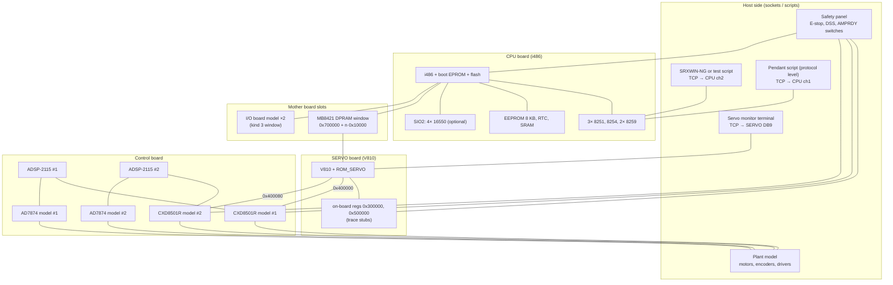

# SRX-C61 whole-system emulator — plan

Plan for a software model of the SRX-C61 controller that runs the **original firmware of
every board** together: CPU (i486), SERVO (V810), Control board (2× ADSP-2115) and,
optionally, the teach pendant (HD64180). The model is meant for finding ways to revive the
real unit: watch the boot, reproduce errors, test SRXWIN-NG against it, and try hardware
hypotheses without risking the hardware.

This file is the starting point for a coding session. It collects what is known (with links
to the reports), what is missing, how to stub each gap, and the order of work with
acceptance tests.

Related reports: `doc/hardware_overview.md` (boards), `doc/SRX-611_firmware_architecture.md`
(CPU), `doc/servo_dsp_link.md` (SERVO ↔ DSP), `doc/control_board_firmware.md` (DSP),
`doc/TP_firmware_structure.md` (pendant), `doc/SRXWIN_protocol.md` (PC link).

Tags as elsewhere: **[C]** confirmed, **[I]** inferred, **[H]** hypothesis.

---

## 1. Framework: a MAME driver

**Decision: write a MAME driver** ("sony srx_c61"). Every CPU core needed is already in
MAME (checked in the MAME source tree, 2026-10-29):

| Need | MAME core / device | Notes |
|---|---|---|
| i486DX2 | `cpu/i386` (`I486DX4`/`I486` types) | real → protected mode, paging not used by pSOS here |
| NEC V810 | `cpu/v810` (Virtual Boy / PC-FX core) | check timing and interrupt model against the µPD70732 |
| ADSP-2115 ×2 | `cpu/adsp2100` → `ADSP2115` | boot loading is done by the driver (`load_boot_data`); see §5.4 for BFORCE |
| HD64180 (pendant, optional) | `cpu/z180` | |
| 8251A ×3 | `machine/i8251` | |
| 8254 | `machine/pit8253` (`PIT8254`) | |
| 8259A ×2 | `machine/pic8259` | cascade on master IR7 |
| PC16550 ×4 (SIO2) | `machine/ins8250` (`NS16550`) | |
| MB8421 dual-port RAM | `machine/mb8421` | has the mailbox/interrupt behaviour built in |
| 28F-type flash | `machine/28fxxx` or plain ROM | the firmware does not have to write flash for a boot |
| serial terminals | `bus/rs232` + `null_modem` / `terminal` | `null_modem` + bitbanger socket → TCP port for SRXWIN-NG and consoles |

Why MAME and not a custom harness (Unicorn + Python): Unicorn has no V810 and no ADSP-21xx.
MAME also gives multi-CPU scheduling with per-CPU clocks, a debugger (breakpoints, watchpoints,
trace to file), save states, Lua scripting (`-autoboot_script`) and headless runs
(`-video none -sound none -nothrottle -seconds_to_run N`).

**Where the code lives.** Keep the driver in this repo under `emu/` (driver `.cpp`/`.h`,
custom device models, Lua test scripts, ROM set layout, a `build.sh`). `build.sh` copies the
files into a MAME checkout and builds only what is needed:

```sh
make SUBTARGET=srx SOURCES=src/mame/sony/srx_c61.cpp REGENIE=1 -j$(nproc)
```

MAME needs ROMs in a set directory (`roms/srx_c61/`) with CRC/SHA1 in the driver. The repo
images are the source; `build.sh` can create the set.

**Resource note** (AGENTS.md §0.5): a MAME build is heavy (several GB, ~30–60 min on a small
machine even with `SOURCES=`). Ask the owner before the first full build; later builds are
incremental.

---

## 2. What is emulated



The real pendant (Z180 + LCD + keypad) is optional (§5.8). The first version talks to the
CPU's pendant channel with a script that speaks the TP protocol.

---

## 3. Firmware inventory and loading

| Board | Image(s) in repo | Load into the model |
|---|---|---|
| CPU boot | `FW/SRX6-CPU/2/U23_M27C256B@DIP28.BIN` (32 KB) | top of the address space, `0xFFFF8000–0xFFFFFFFF`. Its last bytes hold the reset `jmp` (`E9 CD 8B` at `0x7FF0`) [I] |
| CPU main | `FW/SRX6-CPU/2/ROM1-C.bin` (1 MB) | `0xFFE00000–0xFFEFFFFF` (linked there; the image's own top 16 bytes are `FF`, so the EPROM must own the reset vector) [C][I]. Raw flash dumps `U24`/`U25` do **not** simply interleave to it (AGENTS.md §2.1) — use `ROM1-C.bin` |
| SERVO | `FW/SRX6-SERVO/ROM_SERVO.bin` (256 KB) = U41 even + U42 odd bytes | `0x00100000` and the reset alias at `0xFFFC0000`; the firmware copies itself to RAM at 0 [C] |
| Control board | `FW/SERVO_IO/1/U7_…BIN`, `U18_…BIN` (identical, 64 KB) | not CPU-addressable: a boot-ROM region per DSP, pages read by the driver (§5.4) [C] |
| Pendant | `FW/TP/IC6_M27C256B@DIP28.BIN` | Z180 at 0 (optional) |
| Servo PLD | `FW/SRX6-SERVO/2/U43.GAL16V8B.JED` | decode reference (§5.3) |

Open: how the CPU board maps EPROM vs flash at reset (two chip selects or a boot-mode bit).
Read the boot EPROM entry to see where it jumps into the flash: the reset `jmp` at EPROM
`0x7FF0` (real-mode `F000:FFF0`) goes to `F000:8BC0` = EPROM offset `0x0BC0`. [I]

---

## 4. Clocks and timing

| Clock | Value | Source | Status |
|---|---|---|---|
| i486DX2 core / bus | 50 / 25 MHz | spec sheet; 50 MHz oscillator on the board | [I] — check whether the oscillator feeds CLK directly |
| 8254 input | 3.072 MHz | baud/tick maths in the CPU firmware (architecture report §12.3) | [I] |
| CPU tick | 100 Hz (`KC_TICKS2SEC`) | firmware | [C] |
| V810 | 25 MHz (µPD70732GD-**25**) | part number | [I] |
| ADSP-2115 | KP-66 speed grade; crystal next to each DSP | part number, photo | **measure** |
| DSP SPORT0 SCLK | CLKOUT / 56 | `SP0_SCLKDIV = 27` | [C] relative |
| PWM carrier | period register `1000` counts; count clock unknown | DSP init | **measure** (PWM frequency at a driver) |
| DSP IRQ1 (ADC done) | follows ADC conversion start (`$3025` write) | DSP code | rate = current-loop rate, **measure** |
| DSP IRQ2 | supervision/sync; source unknown (CXD8501R? SERVO?) | DSP code | **unknown** |
| SERVO → CPU slot IRQ | the servo cycle; paces the CPU SVT task | CPU code | **measure** or infer from SERVO timers |

Watchdogs exist on several links (`SERVO CPU communication error`, `SVO WATCHDOG ERR`,
`host CPU watch dog timer error`, DSP-side heartbeat). Rates do not have to be exact, but
the **ratios** must keep every timeout from firing. Start with guesses, then fix them from
the error behaviour or measurements.

---

## 5. Board models

### 5.1 CPU board

Known maps: architecture report §4.1 (memory), §4.2 (ports), §4.3 (interrupts).

| Item | Model | Notes |
|---|---|---|
| RAM | 2 MB at 0 (region 0 is clamped to `0x200000`) | real board has 512 KB SRAM [P] — check which the firmware probes |
| EPROM / flash | ROM regions §3 | flash writes: log them, ignore at first |
| 8251 ×3 | `i8251` at ports `0xC0/C4`, `0xC8/CC`, `0xD0/D4` | ch1 TP, ch2 PC, ch3 user → `rs232` ports with `null_modem` |
| 8254 | `0xB0–0xBC`, input 3.072 MHz | ctr0 tick → slave IR2; ctr1/2 baud clocks |
| 8259 ×2 | master `0xA0/A4`, slave `0xA8/AC`, cascade master IR7 | vectors `0x20/0x28` |
| RTC | ports `0x60–0x9C`, 16 BCD registers | an MSM6242-like part; `msm6242` device or a small register model |
| EEPROM 8 KB | memory `0x600000`, busy flag port `0x0C` | **content needed** (§6.1) |
| PC card | window `0x200000`, port `0x4C` bit 0 | empty slot at first; later an SRAM card image (FAT12) |
| Slot latches | ports `0x30–0x40` | log; probably slot ID/IRQ routing [H] |
| Diagnostic port | `0x20` (`0x0F` = fatal halt) | log every write: this is the boot progress indicator |
| SIO2 | `0x2000000`, status `0x2000010`, slave IR6/IR7 | four `ns16550` + a small decoder model; can be left out (firmware probes it) |

### 5.2 Mother board and slots

- Five DPRAM windows at `0x700000 + (s−1)·0x10000`, IRQs master IR4–6, slave IR0–1
  [C]. One window per slot board.
- Owner's population: SERVO, I/O, I/O, two empty [O]. Slot order is unknown: make it a
  config option.
- Window layout (architecture report §8.4): `+0x00` info, `+0x01` kind (1 servo, 3 I/O),
  `+0x04` handshake, `+0x10` doorbell, `+0x14` servo-on bits, `+0x18` axis mask, `+0x1C`
  status, `+0x20` parameter, `+0x100·(k+1)` per-axis blocks, `+0xF00` version string,
  `+0xFFC` IRQ mailbox [C]. The SERVO firmware uses the same offsets at its `0x200000` [C].

**Model:** for the SERVO slot, one `mb8421` between the i486 bus (`0x700000+…`) and the V810
bus (`0x200000`); its two mailbox interrupts become the CPU slot IRQ and a V810 interrupt
(which V810 line: to find, §6.4).

### 5.3 SERVO board (V810)

Known (`doc/servo_dsp_link.md`): ROM at `0x100000` copied to RAM at 0; RAM up to at least
`0x7FFFF` (stack top `0x7F800`); `gp = 0x2BAEC`; CPU DPRAM `0x200000`; DSP windows
`0x400000` / `0x400080`.

Unknown, to model as trace stubs first (address constants: `FW/SRX6-SERVO/ROM_SERVO_periph.txt`):

| Region | Seen | First guess |
|---|---|---|
| `0x300000–0x309FFF` | `0x308004 ← 0xFF` at boot, `0x305010/20`, `0x30802C–3C`, `0x300002–6`, `0x301000…0x309000` | LEDs, DIP switch, timers, monitor UART, output latch `0x2812C` shadow → pointer `0x2805C` |
| `0x318000–0x31803C` | one write | |
| `0x500000–0x50004C` | stride `0x10` | a second peripheral, maybe the CXD8477Q pair |
| V810 interrupts | vector table in the copied ROM top (`0x7FE00`) | which lines: DPRAM, timer, monitor UART, DSP |

**Fastest way to the console:** find the monitor UART in `0x300000…` (look for the code that
prints the banner string at `0x21CDA` and follow it to the transmit-register write), model
it as an 8251 or a simple TX/RX register pair, and connect it to a TCP terminal.

The output latch written through `0x2805C` (bits `0x0800`, `0x1000`, `0x2000` around servo on
and ABS read) probably drives driver enables / brake / ABS request lines → connect it to the
plant (§5.6). Check where `0x2805C` is set.

### 5.4 Control board (2× ADSP-2115)

Per DSP (`doc/control_board_firmware.md`):

| Item | Model |
|---|---|
| Boot | Driver reads the EPROM pages (8 KB stride, `(byte3+1)·8` words, 4 bytes/word) into internal PM on reset. **BFORCE:** a write to `SYSCNTL` (DM `0x3FFF`) with bit 9 set must reload page `BPAGE` (bits 6–8) and reset the core **without clearing DAG registers** (page 1 relies on page-0 M values). Check whether MAME's `adsp2101_device` handles BFORCE. If not, hook the DM write in the driver and call `load_boot_data` + a soft reset |
| DM `0x3000–0x303F` | **CXD8501R model**, shared with the V810 window (`0x400000 + 2·n`) |
| DM `0x3200` | output latch (bit 7 heartbeat LED) — log |
| DM `0x3400` | **AD7874 model**: 4 sequential reads give CH1–CH4 |
| DM `0x1000/0x1001` | monitor DAC — log / plot |
| IRQ1 | AD7874 INT (end of conversion) |
| IRQ2 | supervision tick — source unknown; first: a periodic timer at the guessed servo rate |
| FLAG_IN | an enable/handshake input — wire to the safety panel (default: the level that lets `0x8001` succeed) |
| FLAG_OUT | "motor enabled" output — feed the plant / drivers |
| SPORT0 | serial absolute encoder for motor A or B (started by `0x8082/0x8084`) — encoder frame model (§5.6) |

**CXD8501R model** (one per DSP, 64 × 16-bit registers, both buses see the same file):

| Word | Behaviour in the model |
|---|---|
| `$3000–$301F` | plain shared RAM (mailbox). No hidden logic needed: both firmwares define the protocol |
| `$3021` | control/status: store writes; reads return the stored value OR status bits (`$0080`, `$0380`, `$E000`) from the plant/safety model |
| `$3022`, `$3023` | fault/enable bits: store; drive the plant enables |
| `$3025` | write `$0080` → start an ADC conversion → AD7874 INT after the conversion time → DSP IRQ1 |
| `$3026/$3027`, `$302A/$302B` | **24-bit position counters** motor A / B (low 16 bits; byte = bits 23..16). Written by the DSP after an ABS read and by the SERVO (preset); count A/B pulses from the plant |
| `$3029`, `$302D` | per-motor latch read twice for a stable value — meaning still open |
| `$302F`, `$303F` | status: store; `$303F` bits 2–5 from plant/safety |
| `$3030`, `$3031` | driver module ID (4 bits per motor: `8`, `9`, `A`, `C` known) + ready bits `$1010` (active low) |
| `$3033–$303C` | PWM period / set-up / six compare registers → plant model |

Start with "store + log every access", then add behaviour as the trace shows what is needed.

### 5.5 I/O boards

The CPU sees them as slot windows with kind byte `3`; `+0x00` low nibble = input groups,
high nibble = output groups (×8 points) [C]. **Model:** a window with fixed info/kind bytes
plus input and output registers (offsets: find them in the SYST scan at `0x108FC`), bound to
a simple "field I/O" panel in Lua. No firmware on the board (only an EPM7032 footprint).

### 5.6 Plant: drivers, motors, encoders

A simple model per axis, enough to keep the firmware happy:

- driver: enable (from CXD8501R / SERVO latch / FLAG_OUT), ready flag, module ID;
- motor: duty from the 3 PWM compares → current → torque → speed → position (one inertia,
  friction; per-axis constants);
- currents → AD7874 channels (two phases per motor);
- encoder: incremental count → `$3029/$302D`-type registers; absolute position + status
  (battery, shock, UVW) → SPORT0 frames when the DSP clocks them.

The SPORT0 frame format is decoded in `doc/abs_encoder_protocol.md` (§8 there is the
recipe for the model): DR0 sampled at SCLK, one bit per 16 samples, two 24-bit blocks with
CRC-5 x⁵+x²+1, block 1 = status + position bits 23..16, block 2 = position bits 15..0. The
motor is selected by the DSP's `$3200` bit 0. Line coding and status bits are still to be
confirmed on hardware.

### 5.7 Safety chain (SPD panel)

Model as switches with safe defaults: E-stop released, DSS on, AMPRDY ok, no over-speed.
Each one can be flipped from Lua to reproduce `E400` (SPD over speed), `E401` (DSS off),
the servo board's `emergency stop signal is detected`, `AMPRDY signal detected`, etc.
Where the signals enter: the CPU (ports/slot latches?), the SERVO board (`0x300000…`
inputs), the DSP (FLAG_IN, `$3021`/`$303F` bits). Fill in from the traces.

### 5.8 Teach pendant

- **Phase 1:** protocol-level script on CPU channel 1. The CPU-side command table and the
  `SRX6` ↔ `TP4` handshake are known (architecture report §8.1, TP report). This gives
  screens and key presses as text.
- **Phase 2 (optional):** real Z180 firmware with a model of its display (20 characters)
  and keypad. Needs the display controller type and the key matrix (photo of the pendant
  board).

---

## 6. Missing data — obtain or stub

Priority: **P1** blocks a milestone, **P2** needed for a realistic run, **P3** nice to have.

| # | Missing | Prio | Stub | How to obtain |
|---|---|---|---|---|
| 6.1 | **EEPROM 8 KB contents** (robot model, SLOT/AXIS, parameters) | P1 | Build an image from `sys_config_validate` (`0x8BD4`) and its field validators: list fields, legal ranges, checksum; fill with defaults for an SRX-611 L6015 with 4 axes on one servo slot | **Dump the chip from the CPU board** (find its part number on the board; read with a programmer). Do this before any other work on the real unit |
| 6.2 | Battery-backed SRAM / PC card (LUNA programs, points) | P3 | Empty; load programs later through SRXWIN-NG | Dump if the battery still holds |
| 6.3 | CPU reset mapping (EPROM vs flash), RAM size probe | P1 | Map as in §3; trace the boot EPROM | Read the boot EPROM code; continuity of chip selects if unclear |
| 6.4 | V810 interrupt sources and the `0x300000`/`0x500000` registers | P1 | Trace stubs; vector table from `0x7FE00` | Firmware first; then the S6S-* PLDs (read if not secured) and continuity |
| 6.5 | Monitor UART on SERVO | P1 (for stage 1) | Find from the banner print path | Firmware |
| 6.6 | CXD8501R behaviour beyond the mailbox | P2 | §5.4 table | Logic analyser on the Control-board bus while the real unit runs |
| 6.7 | DSP IRQ2 source and rate; IRQ1 rate; PWM count clock | P1 | Guessed rates | Scope on a running unit: IRQ pins, PWM at the driver, crystals |
| 6.8 | Serial absolute-encoder frame (SPORT0) | P2 | "done" frames, log | DSP state machine; logic analyser on the feedback connector |
| 6.9 | GAL20V8B "WEP089" (Control board), S6S-* (SERVO) | P3 | Decode taken from firmware | Programmer (TL866 or similar), if not secured |
| 6.10 | Altera EPM7xxx logic (CPU, SIO2, I/O, SPD) | P2 | Behaviour from firmware (§5.1, 5.5, 5.7) | Usually secured: behaviour only |
| 6.11 | I/O board register offsets | P2 | Trace stub | SYST scan code `0x108FC` |
| 6.12 | Safety signal paths | P2 | Switches with safe defaults | Pin-out of SPD DB25/DB15/DB9 by continuity |
| 6.13 | Real slot order | P3 | Config option | Look in the cage; SLOT/AXIS screen on a running unit |
| 6.14 | Pendant LCD/keypad hardware | P3 | Protocol-level script | Photo of the pendant board |
| 6.15 | Sony service manual for SRX-C61 / SRX-600 series | P2 | — | Search second-hand / archive sources; it may contain schematics and parameter lists |

---

## 7. Stub methodology

1. **Trace stub as the default device.** Every unmapped access goes to a stub that logs
   `{cpu, pc, addr, r/w, size, value, time}` to a CSV and returns a per-address configurable
   value (default `0` or `0xFFFF`). Nothing silently disappears. Mark first-time accesses so
   new registers stand out.
2. **Register spec file.** Grow one YAML file per unknown block from the traces and the
   firmware (`emu/regs/*.yaml`). Example entry:

   ```yaml
   cxd8501r:
     - word: 0x25
       name: ADC_CTRL
       access: w
       on_write: {0x0080: start_adc}
       seen_at: [dsp:0x0223, dsp:0x03F4, dsp_p2:0x001E]
       confidence: I
   ```

   The driver reads it (or a generator turns it into C++ tables). The YAML is also the
   documentation, so keep `doc/` links in it.
3. **Contract models.** Where both sides of an interface run real firmware (CPU ↔ SERVO
   DPRAM, SERVO ↔ DSP mailbox), the model is shared memory + interrupts and nothing more.
   Never invent protocol logic that one of the firmwares already implements.
4. **Isolation with record/replay.** Bring up each board alone with a Lua script playing the
   peer (e.g. send `0x8001` to the DSP mailbox and check that it is acked). Record the
   traffic of a working pair and replay it in regression tests.
5. **Fault injection.** Every external condition (E-stop, DSS, AMPRDY, battery, shock,
   over-speed, driver fault, ADC offset) is a switch in Lua. A test can flip it and assert the
   expected error code on the pendant/PC link.
6. **Progress probes.** Use what each firmware already exposes: CPU port `0x20` writes, pSOS
   task creation (`t_create` calls), SERVO monitor text, DSP heartbeat bit (`$3200` bit 7),
   ack of mailbox commands. Each milestone below is an assertion on these.

---

## 8. Milestones and acceptance tests

| Stage | Scope | Done when |
|---|---|---|
| **0. Skeleton** | `emu/` folder, `build.sh`, empty driver with the four CPUs and ROM loading, trace stubs everywhere | MAME starts the driver headless; each CPU fetches its first instructions (trace shows the reset vectors) |
| **1. SERVO alone** | V810 + RAM + monitor UART + trace stubs; DPRAM and DSP windows as RAM | Banner `*** Servo Board Monitor / Copyright(C) 1995 Sony Corp. ***` on the TCP terminal; `HELP` and `VER` answer |
| **2. Control board alone** | 2× ADSP-2115, boot pages + BFORCE, CXD8501R + AD7874 stubs, IRQ1/IRQ2 timers | Both DSPs reach the page-1 main loop; the heartbeat bit toggles; a Lua script sends `0x8001`, `0x8002` and sees the ack, then changing PWM compares |
| **3. SERVO + Control** | Connect the windows `0x400000/0x400080` to the CXD8501R models | Monitor `CONNECT` succeeds; servo on/off from the monitor gives `0x8001`/`0x8002…` and acks; `ABSCOPY` runs the SPORT0 path |
| **4. CPU alone** | i486, boot EPROM → flash, 8251/8254/8259, RTC, EEPROM image (6.1), PC card empty, slots with dummy kind bytes | pSOS+ starts its tasks; `SRX6`/`TP4` handshake on ch1; SRXWIN-NG (or `SRXWIN` under DOSBox-X via a virtual serial port) reads the error history over ch2 |
| **5. Whole system** | CPU ↔ SERVO via MB8421 DPRAM + IRQs, I/O boards, plant, safety panel | No communication/watchdog errors; servo on through the pendant script; a LUNA move program sent through SRXWIN-NG moves the model axes |
| **6. Revival experiments** | Fault injection, error reproduction | Each error the real unit shows can be reproduced in the model and traced to its cause |
| 7. Pendant hardware (opt.) | Z180 + display + keypad | The real pendant screens render |

---

## 9. Data to collect from the real unit

In this order; stop at any step that risks damage.

1. **Dump the CPU-board EEPROM** (and SRAM/PC card if present). Note every chip marking on
   the CPU board near it.
2. **Read the GALs** (Control board GAL20V8B ×2, SERVO S6S-* if they are GAL/PAL types).
3. **Crystals:** read the markings near the ADSP-2115s, the V810, the SIO2 and the CPU.
4. **If the unit powers up:** scope the DSP IRQ1/IRQ2 pins, a PWM line at a driver, the SERVO
   slot IRQ on the backplane; photograph the pendant screens and the error history.
5. **Logic analyser:** SPORT0 (DSP ↔ encoder) during `ABSCOPY`; the SERVO 50-pin cable
   (address/data/strobes) during power-up.
6. **Continuity:** feedback connector → Control board; SERVO TX3-50P → Control board; SPD
   front connectors.

---

## 10. Risks

- **Secured PLDs / custom ASICs.** Behaviour must come from the firmware. Mitigation: the
  contract approach (§7.3) and traces; keep each model minimal.
- **MAME core gaps.** V810 timing or exceptions, ADSP-2115 BFORCE/boot paging, i486 corner
  cases. Mitigation: small patches in the driver; upstream them later.
- **Timing-sensitive watchdogs.** Mitigation: rates as config, scan for the tolerated range.
- **EEPROM not readable / lost.** Mitigation: synthesise from the validator (6.1); the
  pendant may also allow parameter entry once the system runs.
- **Build size.** Mitigation: `SOURCES=` build; reuse the checkout between sessions.

---

## 11. First tasks for the coding session

1. Clone MAME (shallow), confirm `SUBTARGET` + `SOURCES=` builds a minimal driver; record the
   build time and size (ask before running it — AGENTS.md §0.5).
2. Create `emu/` with `build.sh`, `srx_c61.cpp`, a trace-stub device and the ROM set layout.
3. Stage 0, then Stage 1: find the SERVO monitor UART (banner path from string `0x21CDA`)
   with `tools/v810/v810dis.py` and model it.
4. In parallel (no build needed): analyse `sys_config_validate` (`0x8BD4`) to list the
   EEPROM fields (6.1), and the boot-EPROM entry for the reset mapping (6.3).
5. Keep `history.md` and this plan up to date (mark stages done, move facts into the board
   reports).
