# SRX-C61 controller — hardware overview

Structure of the SRX-C61 controller (the box that drives the SRX-611 arm), put together from
board photos (2026-10-29), the owner's notes on how the boards sit in the chassis, and what
the firmware analysis has shown so far.

How sure each statement is:

- **[P]** read directly off the board photo (part number, silkscreen, connector);
- **[F]** confirmed by firmware analysis (CPU `ROM1-C.bin`, servo `ROM_SERVO.bin`,
  Control board DSP code — see `doc/control_board_firmware.md`);
- **[O]** stated by the owner after inspecting the unit;
- **[H]** hypothesis — still to be checked (continuity test, scope, or firmware).

The owner has **two controller units**. They differ in the CPU board: in one, the i486 sits
in a socket and the SRX6-SIO2 serial mezzanine is fitted on top; in the other, the CPU is
soldered under a heatsink (photo labelled "SRX-CPU 2").

---

## 1. Whole controller

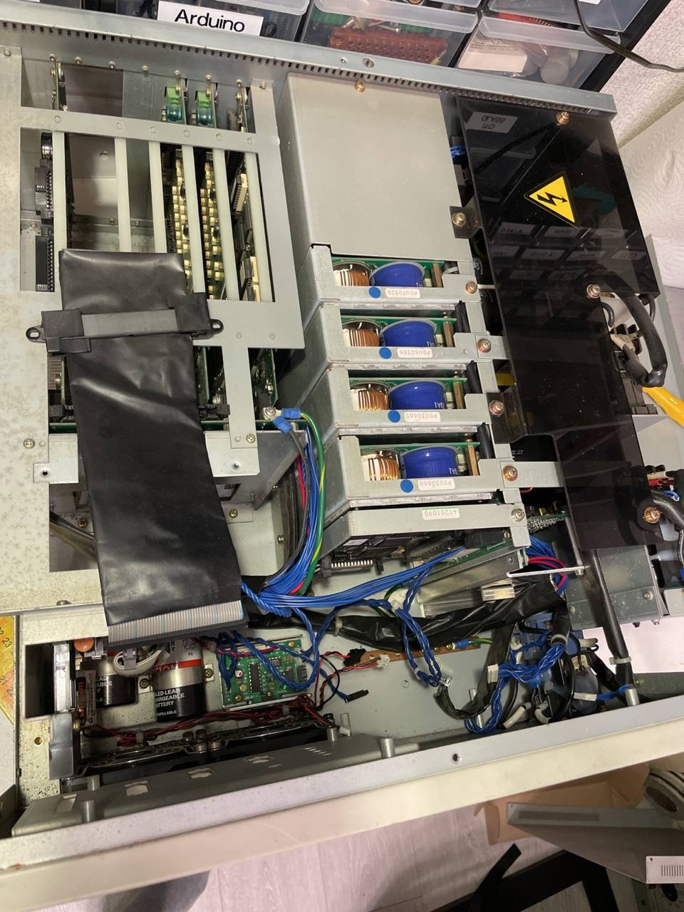

*Top view, front of the unit at the bottom. Top left: card cage (CPU + SIO2 mezzanine, two
I/O boards, SERVO). Centre: four motor drivers and, below them, the Control board. Right:
contactors under the black cover. Front edge: the L-shaped SPD panel board, the sealed
lead-acid back-up batteries and their small charger board.* [O][P]

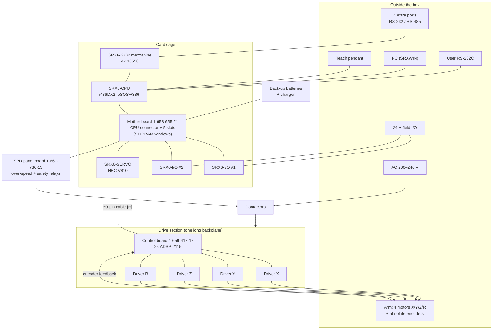

Key points:

- **Card cage.** CPU board (with the SIO2 mezzanine on one unit), two SRX6-I/O boards and
  **one** SRX6-SERVO board, all on the Mother board. [O] The CPU firmware polls **five slot
  windows** (`0x700000 + n·0x10000`) and classifies boards by a kind byte (1 = servo,
  3 = I/O). [F] The Mother board has one CPU connector and five identical slot connectors
  [P], so 3 of the 5 windows are used here: one servo (kind 1) and two I/O (kind 3). Which
  physical slot maps to which window is still to be confirmed. [H]
- **One SERVO board drives all four axes.** So the CPU's SLOT/AXIS setting must map axes
  1–4 to sub-axes of a single servo slot. [O][H]
- **Drive section.** The four driver modules and the **single** Control board plug into
  one long backplane. Motor power comes into this backplane, and the encoder/feedback
  connector is on it. The feedback signals reach the Control board's connector. [O]
  Whether the Control board uses them or passes them on to SERVO is not yet known. The
  DSP code shows no encoder handling so far, which points to "passed on". [H] (§7)
- **Control board** has two ADSP-2115 DSPs; each runs the current loop and the 3-phase
  PWM for **two axes**. [F]
- **SPD panel board** (front, L-shaped) carries the over-speed detector and the safety
  relays that drive the contactors, plus the front-panel connectors. [P][H]

---

## 2. SRX6-CPU — main CPU board (1-676-745-11)

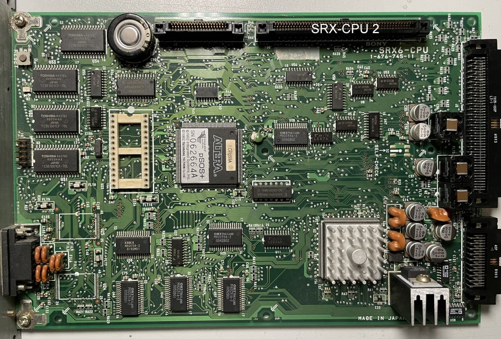

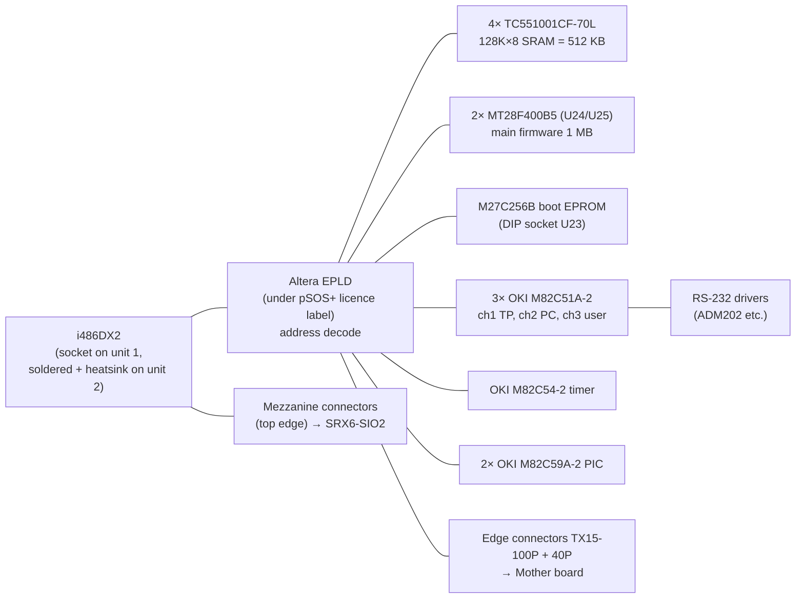

| Item | What | Source |
|---|---|---|
| CPU | Intel i486DX2 (50 MHz internal), flat 32-bit protected mode | [P][F] |
| RAM | 4× Toshiba TC551001CF-70L (128K×8) = 512 KB | [P] |
| Main firmware | 2× MT28F400B5 (U24, U25) → `ROM1-C.bin` 1 MB | [F] |
| Boot | M27C256B in a DIP socket (empty on the photo: removed for dumping) | [P][F] |
| Serial | 3× OKI M82C51A-2 (TP / PC / user RS-232C) | [P][F] |
| Timer, IRQ | OKI M82C54-2, 2× OKI M82C59A-2 | [P][F] |
| Glue logic | Altera PLD (part number hidden under the pSOS+ licence label "SN 062664A") | [P] |
| Other | 50 MHz oscillator, RESET and SELF-CHECK switches, back-up cell for the RTC, DB9 on the bracket | [P][H] |

Memory and I/O maps are in `doc/SRX-611_firmware_architecture.md`.

---

## 3. SRX6-SIO2 — 4-channel serial mezzanine (1-674-196-11)

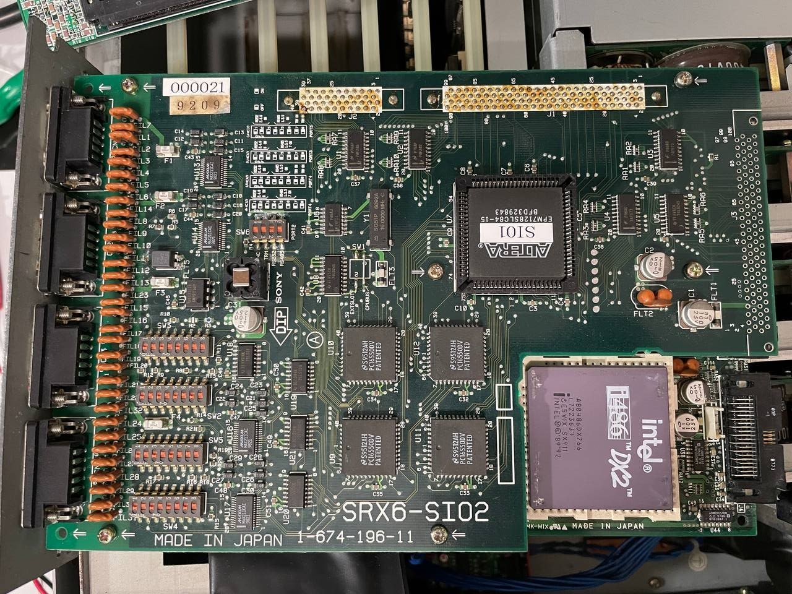

This board is the **"optional 4-channel serial board"** that the CPU firmware probes at
`0x2000000` (status register `0x2000010`, IRQ slave 6/7; architecture report §8.5). It
sits on top of the CPU board through J1/J2. It has a cut-out over the CPU, so the i486 of
unit 1 (in a socket) stays reachable at the lower right. [P][F]

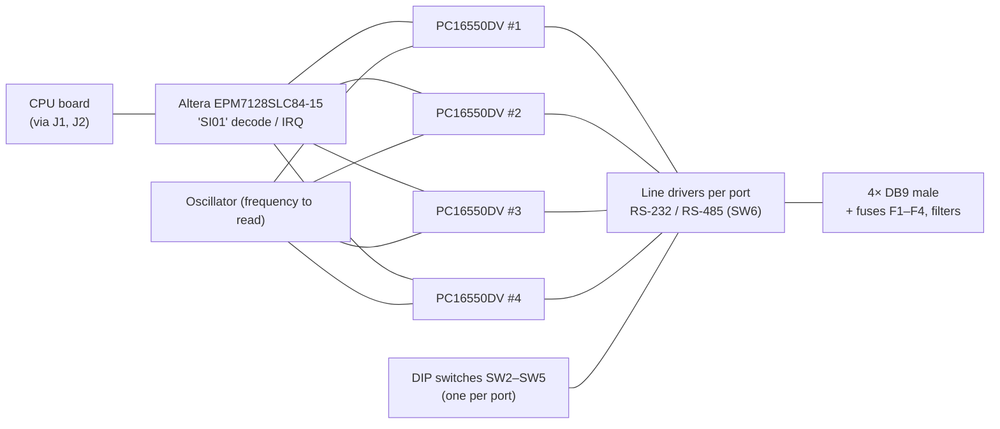

| Item | What | Source |
|---|---|---|
| UARTs | 4× National PC16550DV (U9–U12) | [P] |
| Decoder | Altera EPM7128SLC84-15, label "SI01" | [P] |
| Mode select | SW6 silkscreen "RS232 / RS485" per port; SW2–SW5 8-way DIP per port (termination / mode?) | [P][H] |
| Connectors | 4× DB9 with fuses F1–F4 (probably on a supply pin) | [P][H] |
| Not on unit 2 | Unit 2's CPU board has no mezzanine | [O] |

---

## 4. Mother board — card-cage backplane (1-658-655-21)

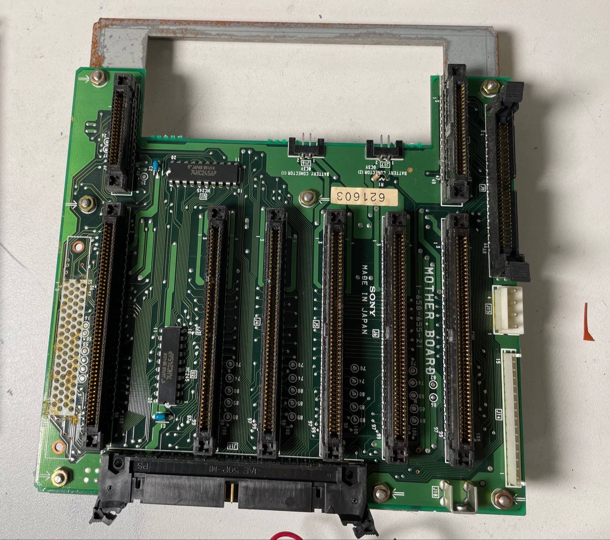

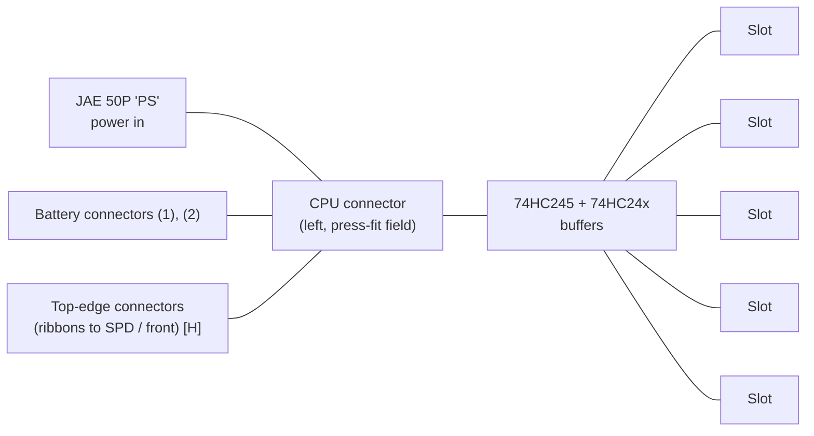

- One CPU connector plus **five** identical 100-pin slot connectors. This matches the five
  DPRAM windows of the CPU firmware. [P][F]
- Under each slot connector there is a column of pads/test points (70, 74, 80, 85, 89, 100).
  This may be a hard-wired slot number. [P][H]
- Two battery connectors: back-up for the absolute encoders (and the RTC/SRAM?). [P][H]
- Population in the owner's unit: SIO2 is on the CPU board; the slots hold I/O, I/O and
  SERVO; two slots are empty (room for a vision board or a second SERVO for a second
  robot — the firmware runs per-robot SVTn/TJTn tasks). [O][F][H]

---

## 5. SRX6-SERVO — servo/motion board (1-…-653-12, GCMK-M1X)

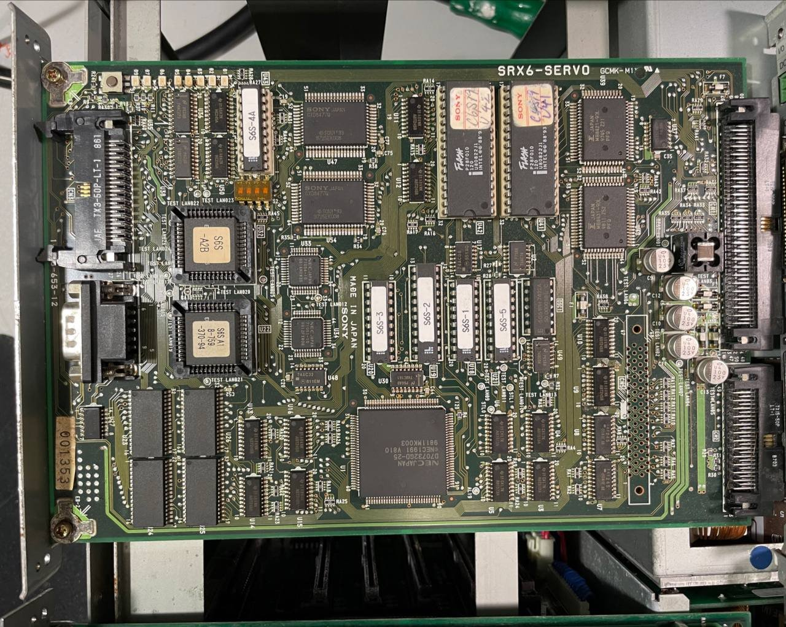

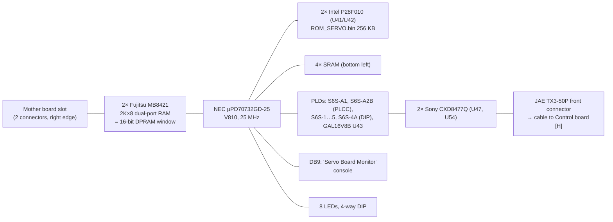

| Item | What | Source |
|---|---|---|
| CPU | NEC µPD70732 V810 (code at `0x00100000`) | [P][F] |
| Firmware | 2× P28F010, byte-interleaved → `ROM_SERVO.bin` ("Servo Board Monitor ©1995 Sony") | [F] |
| Host link | 2× MB8421 dual-port RAM — the CPU board sees it as one slot DPRAM window (kind byte 1) | [P][F] |
| Custom ASICs | 2× Sony CXD8477Q. One per Control-board DSP? Candidates: link to the DSPs, or encoder receivers | [P][H] |
| Front | TX3-50P (to the Control board, to confirm) and DB9 monitor port | [P][H] |

The monitor's `AMP ERROR(axis 1/2)` texts probably mean **DSP channel 1/2** of the Control
board (each DSP drives two motors), not robot axis 1/2. [H]

---

## 6. SRX6-I/O — 24 V digital I/O board (1-658-654-21, GCMK-G3X)

| Side A | Side B |
|---|---|
| 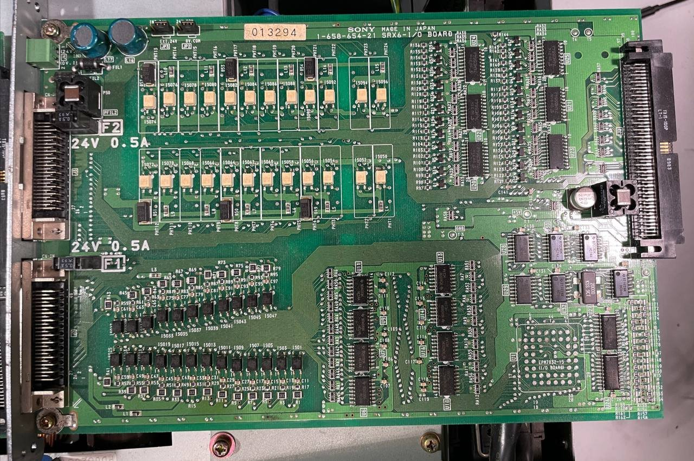 | 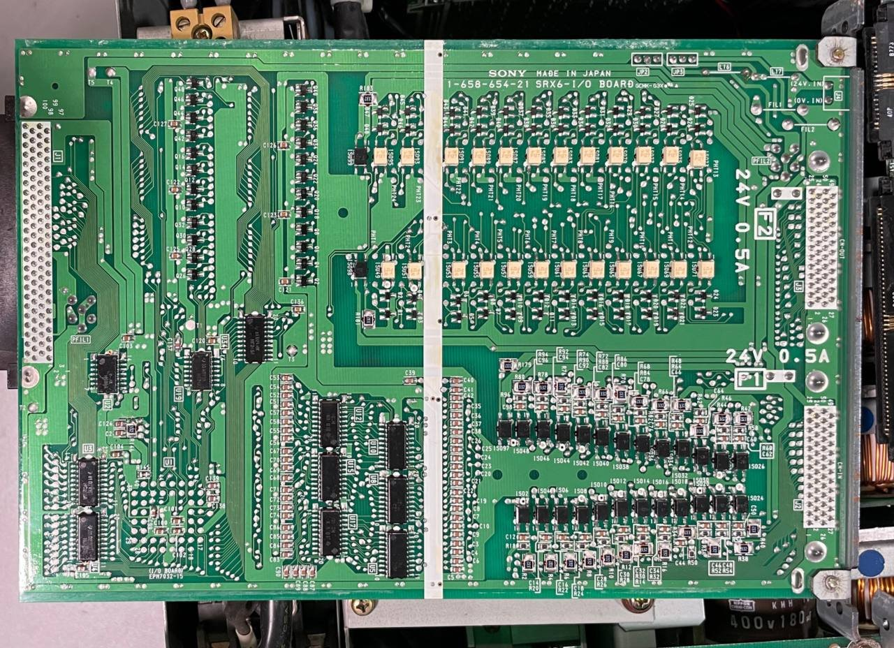 |

The two photos show the **two sides** of the board: B is a mirror image of A, with the
front connectors on the right and the backplane field on the left. Photocouplers are
fitted on both sides (even ISO numbers on A, odd on B). [P]

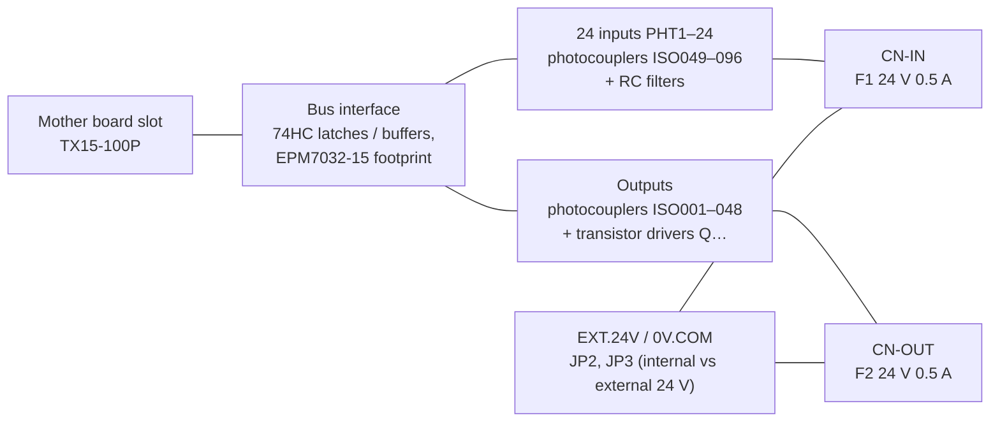

- 24 inputs (PHT1–PHT24) are certain. There are about 48 photocouplers in the input area
  (ISO049–096, both sides). That suggests two per input (either-polarity inputs?) or a
  second group of 24 inputs. [P][H]
- Outputs: photocouplers ISO001–048 plus transistor drivers. The exact output count is to
  be confirmed. [P][H]
- The firmware sees the board as slot **kind 3**; it is scanned by SYST (`0x108FC`). [F]

---

## 7. Control board — DSP current controller (1-659-417-12, PCB 412310028)

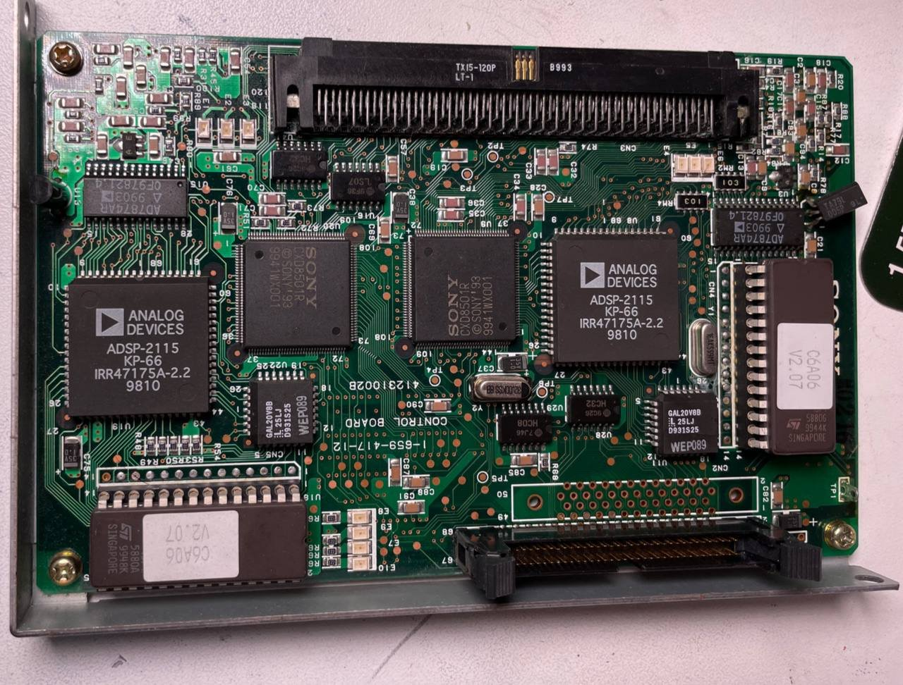

**One** board per controller. It plugs into the drive backplane together with the four
drivers. [O] Its two EPROMs are the dumps in `FW/SERVO_IO/1/` (folder name kept for
history). Firmware analysis: `doc/control_board_firmware.md`.

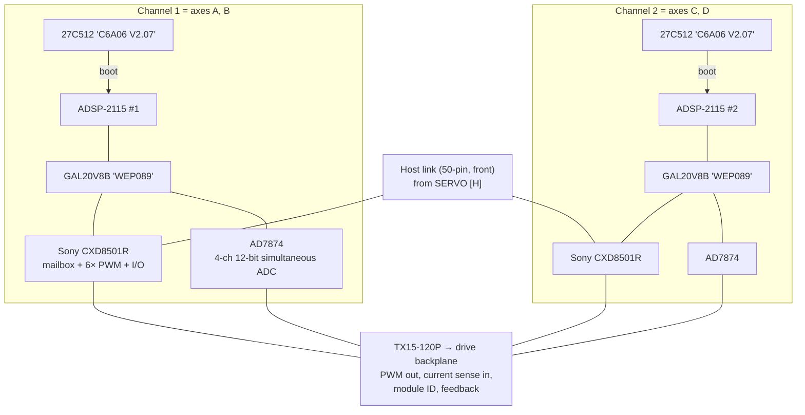

| Item | What | Source |
|---|---|---|
| DSP | 2× Analog Devices ADSP-2115 KP-66, booting from byte-wide EPROM | [P][F] |
| EPROM | 2× ST 27C512 "C6A06 V2.07" — **identical** images (`U7`/`U18` dumps, same MD5) | [P][F] |
| ADC | 2× AD7874AR: 4-channel, 12-bit, simultaneous sampling; read as 4 consecutive words at DSP DM `0x3400` | [P][F] |
| ASIC | 2× Sony CXD8501R: per-DSP peripheral at DM `0x3000–0x303F` (host mailbox, 6 PWM compare registers, status) | [P][F][H] |
| Glue | 2× GAL20V8B "WEP089", 74HC08/HC32/LS07 | [P] |
| Connectors | TX15-120P (top) to the drive backplane; 50-pin header (front) — host cable or feedback, to confirm | [P][H] |

Each DSP drives **two motors**. Its AD7874 gives 2 phase currents per motor, and its
CXD8501R produces 3 PWM phases per motor (6 compare registers). [F][H]

---

## 8. Drive section — drivers and backplane

Seen only in the chassis photo (§1). Four identical driver modules (each with a choke and a
large bulk capacitor) and the Control board plug into one long backplane. That backplane
takes motor power in and carries the feedback connector. [O][P] Each driver reports a
4-bit module ID to the DSP (DM `0x3030`, firmware selects current-scaling constants by it).
[F][H]

---

## 9. SPD panel board — over-speed detector and safety relays (1-661-736-13)

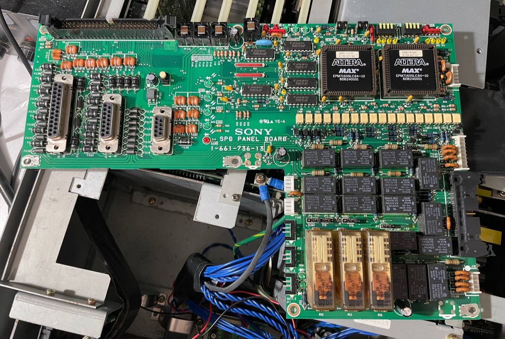

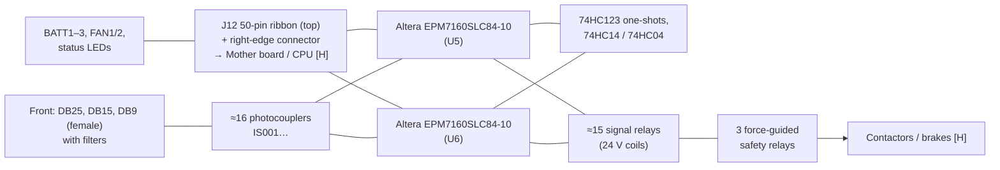

- The two EPM7160s implement the **over-speed detector** behind **E400 "SPD over speed"**.
  The SMART option's **Drive Safety Switch** (E401 "DSS off") is also wired through this
  board. [F][H]
- 74HC123 one-shots: hardware watchdog/heartbeat check. [H]
- The front DB25/DB15/DB9 carry the external safety and emergency-stop circuits and
  probably the I/O or TP lines. To be confirmed by continuity test. [H]
- A design file `SPD_panel_relays.dch` exists on the workstation (AGENTS.md §2.7).

---

## 10. Open questions (hardware)

1. Where does the 50-pin cable from the SERVO front (TX3-50P) go: Control board or SPD?
2. Do the encoder signals stop at the Control board or continue to SERVO? (The DSP code
   shows no encoder handling — `doc/control_board_firmware.md` §6.)
3. Which Mother-board slot is which DPRAM window, and what are the slot pads for?
4. SIO2 oscillator frequency and the meaning of SW2–SW6.
5. Why ~48 photocouplers for 24 inputs on SRX6-I/O; how many outputs.
6. Pin-out of the SPD front connectors (DB25 / DB15 / DB9).
