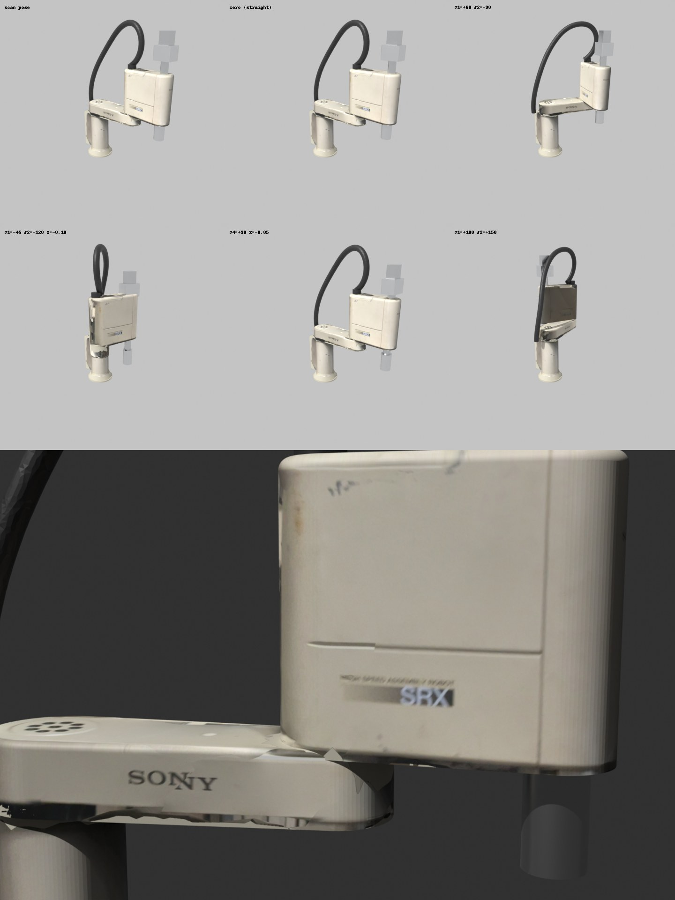

# SRX-611 arm — articulated 3D model from a LiDAR scan

Status: **v2, 2026-11-11** (v1 the same day: raw scan geometry; v2: plate dimensions, cleaned, cables rebuilt),
plus a **simplified model from primitives** (§8). The scan model is built from the owner's scan of the arm
(owner's arm R.No. 82912 / C61-1173). It is meant to be driven by the joint positions
computed in the MAME emulator (`emu/`). See §6 for how to connect them.

| File | What it is |
|---|---|
| `img/3d/srx611_final.jpg` | **Final look** of the primitive model: six poses and a close-up of the baked labels (versioned) |
| `emu/model/srx611.glb` | Articulated model, glTF 2.0 binary with the texture embedded (3.9 MB). Load it in any viewer, three.js or Blender |
| `emu/model/srx611.blend` | Same model as a Blender 4.5 file, texture packed. Edit the segmentation and pivots here |
| `emu/model/joints.json` | Pivots, link lengths, scale and the scan→robot frame transform |
| `emu/model/cables.json` | Centrelines and radii of the two cables (rebuilt as tubes) |
| `emu/model/srx611_prim.{step,blend,glb}` | Simplified model from primitives (CadQuery), same joint nodes (§8) |
| `doc/photos/IMG_3585…3597.jpg` | Owner's photos of the arm (cable routing, top unit, quill, gripper, base). **Not versioned** (owner's request); local reference only |
| `emu/model/scan/Untitled_Scan_11_28_02.zip` | The original scan from 3dScannerApp: `.dae` and an 8K texture |
| `tools/model3d/` | Scan pipeline: `build.sh` (all steps), `dae_to_npz.py`, `segment.py`, `build_blend.py`, `render_poses.py`, `render.py` / `labrender.py` (numpy preview renderer). Primitive model: `build_prim.sh`, `prim_cq.py`, `build_prim_blend.py`, `bake_prim_textures.py` |
| `img/3d/01…26_*.png` | Every intermediate picture (§2–§5, §8). **Local only, not versioned** |

**Versioned in git:** this report, `tools/model3d/`, `emu/model/{joints,cables}.json`,
`emu/model/srx611_prim.{glb,step}` and `img/3d/srx611_final.jpg`. **Local only** (`.gitignore`): the scan zip,
the scan model `srx611.{glb,blend}`, `srx611_prim.blend`, the intermediate pictures and the photos. The
scan zip is also on the owner's drive (`3d_horse/Untitled_Scan_11_28_02.zip`); `build.sh` regenerates
the rest from it.

Rebuild everything with `tools/model3d/build.sh`. It needs python3 with numpy and Pillow, and
Blender 4.5 LTS (`$BLENDER`, default `~/opt/blender-4.5.4-linux-x64/blender`; portable
tarball from download.blender.org, no root needed). Add `PREVIEW=<prefix>` to also write the
segmentation previews.

## 1. Input

- **Source:** 3dScannerApp (iPhone LiDAR). Collada file `Untitled_Scan_11_28_02.dae` plus
  `textured_output.jpg` (8192×8192; only the top 3712 rows are used).
- **Mesh:** one textured triangle mesh, not a raw point cloud. It has 49 169 vertices and
  66 360 triangles. Units are metres; the axes are Y-up, gravity-aligned by ARKit.
- **Contents:** the whole corner of the room — walls, the shelf with the oscilloscope, the
  table — with the robot standing on the table. The robot accounts for about 10 700 of the
  triangles.


## 2. Locating the robot

- **Table top:** the largest horizontal plane is at scan y = −0.845. It is taken as the
  robot mounting surface.
- **Search method:** horizontal slices (`img/3d/05_horizontal_slices.png`,
  `08_arm_slices.png`) plus least-squares circle fits on each slice.

| Feature | Scan (x, z) | Fit |
|---|---|---|
| Column, y −0.80…−0.76 (clean, below the cable) | (0.683, −1.128) | r = 80 mm (Ø160), residual 3 mm |
| J2 hub (arm 1 level) / arm 2 rear rounding | (0.814, −0.792) | r = 32 mm / 66 mm, 4 slices agree to ±3 mm |
| Z/R quill below arm 2 | (0.878, −0.552) | r = 36 mm, 5 slices, residual ≤ 2.4 mm |

The table below compares the link lengths on the scan with the arm's nameplate:

| Length | Scan | Plate (C61-1173, `robot_parameters.md`) | Difference |
|---|---|---|---|
| L1 (J1→J2) | 360.6 mm | 349.847 mm | +3.1 % |
| L2 (J2→quill) | 248.4 mm | 249.699 mm | −0.5 % |

- **Why L1 is off:** the J1 axis can only be fitted on the lower column. Higher up, the cable
  runs down the back of the column and spoils the fit. Either the column is not exactly
  coaxial with J1, or the scan has a local error of about 1 cm.
- **Decision (owner: the model must have the real dimensions):**
  - The scan is scaled by **1.00528**, which makes L2 exactly 249.699 mm.
  - **J1** is placed on the J2→column-centre line at exactly 349.847 mm from J2. This is
    12.7 mm from the column fit (`img/3d/12_J1_axis_candidates.png`), and the arm-1 rear rounding
    fits this point as well as the column centre.
  - The column and foot stay at their scanned place (`column_offset_m` in `joints.json`).
- **Quill:** the visible shaft above the housing (r ≈ 25 mm) is coaxial with the lower quill
  sleeve (r = 36 mm) to within 1 cm.


## 3. Segmentation and cleaning

`segment.py` labels each triangle by its centroid, in the robot frame (§4). It uses height
above the mounting surface `h` and the horizontal distance to the J1 axis, the J1–J2 segment,
the J2–quill segment and the quill axis Q:

| Part | Rule (metres) | Triangles | Moves with |
|---|---|---|---|
| `base` | r(column) < 0.13, 0.045 ≤ h < 0.385; plus the cable entry (h < 0.30, within 0.25 of the column) | 1225 | fixed |
| `link1` | within 0.11 of J1–J2, 0.37 ≤ h < 0.48 | 1511 | J1 |
| `link2` | within 0.085 of J2–Q, 0.43 ≤ h ≤ housing top (0.80) | 1813 | J2 |
| `quill_top` | r(Q) < 0.075 above the housing top: spline-shaft top + aluminium box, plus the coiled cord wrapped round the box | 1117 | J4 (**owner: moves and turns with the head**) |
| `tool` | r(Q) < 0.045, h < 0.43 (quill sleeve) + gripper r(Q) < 0.12, h < 0.375 | 1381 | J4 |

**Cleaning:**
- **Table shadow:** triangles with h < 0.03 and r(column) > 0.105 (the shadow skirt), and the
  flat table surface inside the foot, are dropped.
- **Foot:** the ragged lower edge of the base (h < 0.045) is dropped. A **flange** (r 110 mm,
  12 mm thick) and a **cone** (r 104 → 79 mm, 50 mm high) replace it, as measured on the scan
  slices; photo IMG_3590 shows the round flange with 4 bolts.
- **Islands:** within each part, connected pieces smaller than 4 % of the main piece are
  dropped.
- **Texture:** cropped to the used rows (8192×3712) and the UVs remapped to match.

**Cables** (photos IMG_3585–3597):
- The scanned cable surfaces are thrown away and rebuilt as tubes (`cables.json`, NURBS
  through the fitted centreline, then converted to mesh).
- **Centreline fit:** shortest path between two given end points on a 4 cm-radius graph of
  the cable points, resampled every 3 cm, each sample replaced by the mean of its nearby
  points, then smoothed.
- **`cable_arc`** (spiral-wrapped main cable, r = 20 mm, length 1.52 m): from the conduit elbow
  at the back of the column, at arm-1 height (IMG_3591), over the arc, into the gland at the
  rear of the arm-2 housing top (IMG_3588, 3596). Parent: **J1**.
- **`cable_s`** (coiled cord, r = 20 mm, length 0.15 m): from the arc's down-leg to the bottom of
  the box on the quill. Only this part is in the scan. In reality the cord makes a loop of
  about 250 mm from the box back up to the main cable (IMG_3585, 3597). Parent: **J2**.


## 4. Robot frame and joint hierarchy

- **Frame:** Z up, metres. The origin is the J1 axis on the mounting surface.
- **+X:** the direction J1→J2 in the scanned pose. Owner: at scan time the arm looked
  straight ahead, with J1 in the middle of its stroke. So +X is the robot's forward direction,
  and J1 = 0 is mid-stroke.
- **Scan → robot transform:** stored in `joints.json` (`X_axis_scan`, `J1_scan`, `table_y`).

```
SRX611                (root)
├── base              mesh, fixed
├── foot_flange, foot_cone   primitives
└── J1                rotate about Z (axis 1)
    ├── link1, cable_arc
    └── J2            at (L1 = 0.349847, 0, 0), rotate about Z (axis 2)
        ├── link2, cable_s
        └── J3        at (L2 = 0.249699, 0, 0), translate along Z (axis 3)
            └── J4    rotate about Z (axis 4)
                └── quill_top, tool, spline_shaft (hidden steel cylinder r 25 mm inside the housing)
```

- **Zero pose:** both arms straight along +X. The `link2` and `tool` geometry was rotated by
  −φ about J2 so that this holds.
- **Scanned pose:** J2 = φ = **−6.37°**. It is the default pose in the files and is also stored
  in the root's `scan_pose` custom property.
- **J3 and J4:** they are relative to the scanned quill position and orientation. The absolute
  Z stroke origin is unknown.
- **Custom properties** (exported as glTF `extras`): `joint` = `rot_z` / `loc_z`, and
  `limit_deg` (J1 ±110°, J2 ±150°, from Kapusi 2022 — check against the manual). The root also
  carries `L1_m`, `L2_m`, `scan_scale`, `scan_pose` and `source`.
- **In the `.glb`:** the exporter converts to glTF Y-up, so the revolute joints rotate about
  node **+Y** and J3 translates along **+Y**. Blender +Y becomes glTF −Z.

Check renders in Blender (Cycles, CPU) — scan pose, zero pose and four test poses. Picture 11
is v1; picture 18 is v2:


## 5. Known defects (v2)

- **Scan surface.** It is still the one-sided LiDAR mesh (median edge 2 cm): soft edges, small
  holes, a noisy gripper and a partial top box.
- **Rigid cables.** `cable_arc` is rigid on J1, so for large J2 angles its end leaves the gland.
  `cable_s` is rigid on J2, so it does not follow J3.
  - Fix: skin both tubes to two bones (J1↔J2, and J2↔J3). glTF supports skins, three.js
    deforms them for free.
- **Coiled cord.** Its loop is incomplete.
- **Spline shaft.** It is a primitive: r 25 mm, from h 0.40 to the housing top. It shows
  only when J3 moves.

The clean long-term solution is a model made from primitives (CadQuery/FreeCAD), with the scan
and the photos as reference; see §7.

## 6. Connecting to MAME (plan)

MAME has no 3D renderer; its layouts are 2D. The model is posed **outside** MAME by a viewer
that receives the joint values from the running emulator.

1. **Joint source in the emulator.** This is the plant model (`emulator_plan.md` §5.6): the
   per-axis position that also feeds the encoder counters / SPORT0 frames. Convert it to
   degrees (J1, J2, J4) and millimetres (J3) using the gear/encoder constants from the `.CTR`
   block. Before the plant exists, the encoder counters (`$3026/27`, `$302A/2B` of each DSP)
   can be shown directly.
2. **Export from MAME.** Use the standard output system. In `srx_c61.cpp`, add
   `output_finder<4> m_joint` (`srx_j1_mdeg`, `srx_j2_mdeg`, `srx_j3_um`, `srx_j4_mdeg`;
   integer outputs, hence milli-degrees and µm) and update them on a timer (e.g. 50 Hz).
   - Run MAME with `-output network`. MAME then serves `name = value` lines on TCP port 8000.
   - No Lua is needed. A Lua plugin with `emu.add_machine_frame_notifier` is the alternative
     if the values are easier to read from memory.
3. **Viewer.** Two options:
   - **(a)** A small three.js page: `GLTFLoader` on `srx611.glb`, find nodes `J1…J4`, set
     `rotation.y` / `position.y`. A ~30-line Python bridge relays TCP 8000 to a WebSocket.
   - **(b)** Blender itself: a timer script that reads the socket and sets
     `J1.rotation_euler.z`, and so on.

   Option (a) needs nothing but a browser and is the recommended one.
4. **Container.** The emulator runs in Docker (`emu/Dockerfile`), so port 8000 must be
   published (`-p 8000:8000`).

## 7. Owner's answers and next steps

Answers (2026-11-11):
1. The block above arm 2 is the top of the Z/R shaft. It moves **and turns** with the head, so
   it is `quill_top` under **J4**.
2. At scan time the arm looked straight ahead, with J1 mid-stroke. So J1 = 0 is the scan pose.
3. The model must have the real dimensions. L1 and L2 now match the plate (§2).
4. **The lower unit (the "knob" below the quill sleeve) has its own axis at 45°.**
   - It has no motor of its own. The quill is raised until the gears (white plastic gears,
     IMG_3592–3594) engage, and then turning the quill (J4) turns the lower unit about its
     45° axis.
   - So it is a coupled, mode-dependent 5th degree of freedom. In the model it will be a node
     `J5` under J4, with its axis at 45°. Its angle is changed only while J3 is at the
     engagement height (to be found out from the firmware / the owner).
   - Not modelled yet (owner: do not draw the knob for now).

Next:
- Gripper/lower unit with the `J5` 45° axis.
- Skinned cables (§5).
- The three.js viewer and the MAME outputs (§6).

## 8. Simplified model from primitives (CadQuery)

The owner asked for a simplified model from primitives, without the lower knob for now.
`tools/model3d/prim_cq.py` builds it with CadQuery 2.7, installed in a venv:
`python3 -m venv ~/opt/venv-cadquery && ~/opt/venv-cadquery/bin/pip install cadquery`.
Rebuild with `tools/model3d/build_prim.sh`.

**Pipeline:**
1. CadQuery builds each part as a solid in the local zero-pose frame of the joint that
   carries it.
2. It writes a STEP assembly (`emu/model/srx611_prim.step`, nested `SRX611 > J1 > J2 > J3 > J4`,
   zero pose) and one STL per part.
3. `build_prim_blend.py` assembles the STLs in Blender with the **same nodes and pivots** as the
   scan model and exports `srx611_prim.glb` / `.blend`.

The default pose is the scan pose. A viewer can load either `.glb` without changes.

**Dimensions** (metres, heights above the mounting surface), taken off the scan slices
`img/3d/19_prim_slices_top.png` and `20_prim_side.png` and checked against the photos:

| Part | Joint | Shape | Dimensions |
|---|---|---|---|
| `base` | root | flange + cone + column + rear connector box | flange r 0.110 × 0.012; cone r 0.104→0.079 up to h 0.062; column r 0.077 up to h 0.385, **coaxial with J1**; rear box x −0.145…−0.030, y −0.050…0.100, h 0.060…0.370 (IMG_3591) |
| `link1` | J1 | tapered stadium (hull of two circles) | r 0.088 at J1, r 0.066 at J2, h 0.385…0.475, top edge fillet 8 mm |
| `link2` | J2 | tapered stadium | r 0.066 at J2, r 0.062 at the quill, h 0.465…0.795, top fillet 15 mm |
| `gland` | J2 | cylinder | r 0.030 × 0.030 on the housing top at the main-cable entry (IMG_3588) |
| `cable_arc` | J1 | circle swept along a spline | r 0.020, along the smoothed centreline `cables.json:cable_arc.smooth` |
| `sleeve` | J4 | cylinder | r 0.036, h 0.345…0.465 (aluminium) |
| `spline_shaft` | J4 | cylinder | r 0.025, h 0.400…0.880 |
| `top_box` | J4 | box | 0.120 × 0.090, h 0.875…0.965, vertical edges filleted (IMG_3586) |
| `top_connectors` | J4 | box | 0.070 × 0.060, h 0.965…1.045 |

Simplifications:
- The column is coaxial with J1; the 12.7 mm offset seen on the scan is treated as scan error.
- The housing top is flat. The real one steps down at the rear, where the gland and connector
  panel sit (IMG_3588).
- There are no covers, screws or the 7-hole cap on arm 1.
- **Only the main cable** is modelled, in both models (owner, 2026-11-11). The coiled cord to
  the top box is left out. The main cable is rigid on J1, as in §5.
- The lower knob and gripper are absent.

**Main cable.** The tube follows a smoothing cubic B-spline (`splprep`, tolerance about 6 mm,
25 points; `cables.json: smooth`) fitted through the scan centreline. This removes the wobble
of the raw fit (`img/3d/24_main_cable_smooth.png`). The scan model uses the same curve.

**Texture with the labels** (`bake_prim_textures.py`, run by `build_prim.sh`):
- **Method:** the scan meshes `base`, `link1`, `link2` are appended into the primitive file;
  both models are in the scan pose with the same pivots. Each primitive body part is unwrapped
  (Smart UV Project) and gets a 2048² image. Cycles bakes the diffuse colour "selected to active"
  (cage 2 cm, ray 4 cm).
- **Misses:** texels whose ray misses the scan come back as exact black and are filled with the
  body colour. That is 76 % of the base texels (most of the base is hidden behind the column
  and cable in the scan), 46 % of link 1 and 36 % of link 2.
- **Result:** SONY on arm 1, `HIGH SPEED ASSEMBLY ROBOT / SRX` and the cover seams on the
  housing, and the 7-hole cap on arm 1 (`img/3d/25…26`).
- **Artifacts:**
  - The doubled "N" in SONY is in the scan texture itself (stitching by 3dScannerApp), not
    from the bake. Changing the cage/ray did not change it.
  - The lower edge of arm 1 and the back of the housing carry the dark, shadowed scan colours.
  - Fix for both: retouch the baked images (`*_baked` in the `.blend`) or bake from photos.


