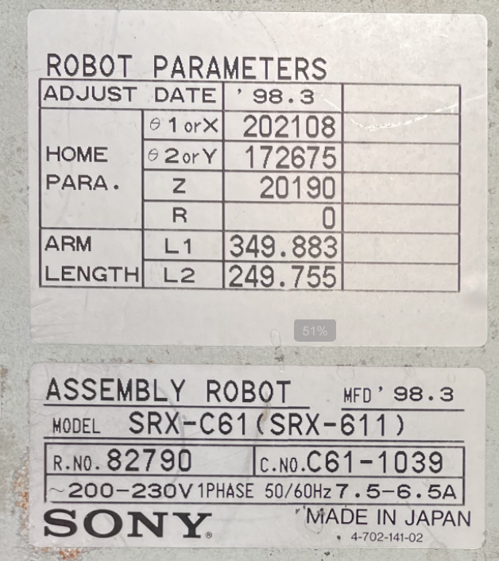
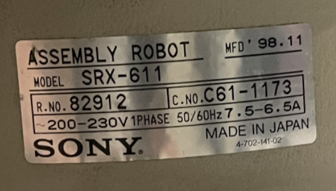
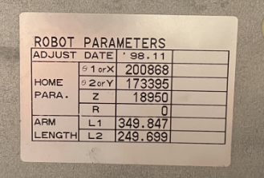

# SRX-611 robot parameters (`.CTR` block): known values

The first EEPROM dumps read blank, but they were invalid (pin 26 RES was left open). A valid
dump of unit 1's U50 now exists (2026-11-11, §4). This file collects every **real** value we
have: the factory plate, the dump, and the related firmware strings.

## 1. Factory plate on the controller (photo 2026-11-08)



"ASSEMBLY ROBOT" plate:

| Field | Value |
|---|---|
| Model | **SRX-C61 (SRX-611)** |
| R.No. (robot number) | **82790** |
| C.No. (controller number) | **C61-1039** |
| MFD | '98.3 (March 1998) |
| Supply | 200–230 V 1-phase 50/60 Hz, 7.5–6.5 A |
| Plate part no. | 4-702-141-02 |

"ROBOT PARAMETERS" plate (factory calibration of **this** arm, adjust date '98.3):

| Group | Axis | Value | Probable unit [H] |
|---|---|---|---|
| HOME PARA. | θ1 or X | **202108** | encoder counts |
| HOME PARA. | θ2 or Y | **172675** | encoder counts |
| HOME PARA. | Z | **20190** | encoder counts |
| HOME PARA. | R | **0** | encoder counts |
| ARM LENGTH | L1 | **349.883** | mm (nominal 350) |
| ARM LENGTH | L2 | **249.755** | mm (nominal 250) |

These values belong to arm 82790, which the owner does **not** have (see §1.1; the owner's arm
is 82912). A `.CTR` from another controller gives everything else, but its HOME PARA and ARM
LENGTH must be replaced with the values of the arm it drives.

The plate is on **unit 1**, the controller with the socketed CPU (CPU board 1-658-652-11,
EEPROM U50; owner, 2026-11-08). **Correction 2026-11-11:** the owner's only arm is 82912
(§1.1), so this box was paired at the factory with a different arm. Unit 2
(CPU board 1-676-745-11) has no matching arm. Its firmware dump (`FW/SRX6-CPU/2/`) is the one
under analysis, but the parameters above apply to it once it drives this arm.

### 1.1 The owner's arm: robot 82912 / C61-1173 (photo 2026-11-11)

 

| Field | Value |
|---|---|
| Model | SRX-611 |
| R.No. / C.No. | **82912** / **C61-1173** |
| MFD / adjust date | '98.11 |
| HOME PARA θ1 / θ2 / Z / R | **200868 / 173395 / 18950 / 0** |
| ARM LENGTH L1 / L2 | **349.847 / 249.699** |

**These two plates are on the owner's arm itself** (under the cover; owner, 2026-11-11). So the
arm is **R.No. 82912**, paired at the factory with controller **C61-1173**, and **these are the
calibration values to use**. None of the owner's parts belongs to C61-1173: the box-1 plate is
C61-1039 / robot 82790, and the two CPU-board EEPROMs hold C61-1161 and C61-1164. The CPU
boards may also have been swapped between the boxes. Known values:

| Source | Controller | Robot | L1 / L2 | HOME PARA θ1 / θ2 / Z / R |
|---|---|---|---|---|
| Plate, box 1 | C61-1039 | 82790 | 349.883 / 249.755 | 202108 / 172675 / 20190 / 0 |
| **Plate on the arm (owner's arm)** | **C61-1173** | **82912** | 349.847 / 249.699 | 200868 / 173395 / 18950 / 0 |
| EEPROM, CPU board 1 (U50) | C61-1161 | ? | 349.839 / 249.857 | 198435 / 172975 / 15023 / 0 |
| EEPROM, CPU board 2 (U26) | C61-1164 | ? | 349.782 / 249.793 | 205654 / 171157 / 12423 / 0 |

None of the four matches another, so four different arms are involved.

## 2. Where the values go in the firmware

The pendant parameter menus exist in the ROM string block (file offsets, used from RAM, see
AGENTS §8.1): `SYSTEM OFFSET` `0xD2D31`, `SERVO PARA` `~0xD2D4C`, `ARM LENGTH` `0xD2D65`,
`HOME PARA` `0xD2D81`, `HOME OFF` `0xD3956`, `HOME POSI` `0xD398E`, `AUTO MEASURE`,
`VIB_CTRL`, `SERIAL No.:` `0xD3587`, `DEF ROBOT NUM`, `SAFETY SPEC`, ` MODEL: SRX-` `0xD0898`.
LUNA also has `GETARML` / `CHGARML` (read and change the arm length).

The fields that E050 checks, in order (the line number shown with E050), are listed in
`doc/SRXMONIE_help.md` §E050: 100 MODEL, 101 SERIAL No., 102 TP language, 103 SAFETY SPEC,
104 DEF ROBOT NUM, 105 ROBOT KIND, 106 INTERFERE, 107 INTERFERE RATIO, 108 REDUCTION RATIO,
109 ENCODER PULSE, 110 CNTR DIR, 111 SLOT/AXIS, 112 HOME OFFSET, 113 HOME POSITION,
114 HOME ORDER, 115 Motion Data Number, 116 SERVO PARAMETER.

Open: map each field to its offset in RAM `0x4A24`–`0x622C` (from `sys_config_validate`
`0x8BD4`) and find out whether the plate's HOME PARA values are HOME OFFSET (112) or HOME
POSITION (113).

## 3. Other known values

| Item | Value | Source |
|---|---|---|
| Arm 1 / arm 2 / Z / R | 350 / 250 mm, Z 150 mm, R ±360° | README §1.1, Kapusi 2022 |
| Joint ranges | axis 1 220°, axis 2 ±150° | Kapusi 2022 (from the manual) |
| Axes on servo slots | 4 axes on one SRX6-SERVO slot | owner, `hardware_overview.md` |

## 4. EEPROM dumps (2026-11-11)

### 4.1 Unit 1, U50 (controller C61-1161)

File: `FW/SRX6-CPU/1/U50_AT28C64@SOIC28.bin`, 8192 bytes, MD5 `f303d4c700707fc68bbf3838d285752b`.
It was read as an AT28C64 with pin 26 (RES) tied to VCC.

It matches the firmware's `.CTR` layout (architecture report §8.7):

- **Offset `0x0000` = `5B 00`** (kind byte `0x5B`, as INIT sets it). **End marker `0xED` at
  `0x1808`**, so the block is `0x1809` bytes long.
- **Robot count `[0x2C]` = 1.** Record 1 at `0x200` starts with **`01 00`**: the word the firmware
  rewrites at every boot. Records 2–6 are zero.
- `0x1809`–`0x1FFF`: an incrementing byte pattern that is not part of the block (probably a
  factory or test fill).
- **Strings:** `C61-1161` at `0x04` and `0x20`, and `611` / `-3` at `0x10` / `0x14`. The model is
  probably SRX-611 with variant `-3` [H].

Decoded fields. The meanings are guesses [H], made by matching values with the plate and the
known joint ranges:

| Offset | Type | Value | Probable meaning |
|---|---|---|---|
| `0xC0` / `0xC8` | double | 110.0 / −110.0 | axis 1 soft limits, deg (range 220°) |
| `0xD0` / `0xD8` | double | 150.0 / −150.0 | axis 2 soft limits, deg |
| `0xE0` | double | 150.0 | Z stroke, mm |
| `0xF0` / `0xF8` | double | 360.0 / −360.0 | R limits, deg |
| **`0x100`** | double | **349.839** | **ARM LENGTH L1**, mm |
| **`0x108`** | double | **249.857** | **ARM LENGTH L2**, mm |
| `0x110`, `0x118` | double | 150.0, 720.0 | Z / R (max speed or stroke?) |
| `0x138`–`0x180` | double | 30, 32, ±600, ±600, 150, ±360 | per-axis limits (unknown) |
| **`0x188`, `0x194`, `0x1A0`, `0x1AC`** | int32, stride 12 | **198435, 172975, 15023, 0** | **HOME PARA** θ1, θ2, Z, R (encoder counts); confirmed by the diff in §4.2 |
| `0x200`… | int16 | 9500, 1250, 3700, 7000, … | robot record 1 (speed/accel tables?) |

**Important: this block belongs to controller C61-1161, not to C61-1039 / robot 82790.**
L1/L2 and HOME PARA differ from the plate in §1 (349.883 / 249.755; 202108 / 172675 / 20190),
although they are of the same kind and size. So the CPU board (or its EEPROM) of unit 1 was
paired with another arm, C61-1161. To drive arm 82790, replace L1, L2 and HOME PARA with the
plate values (and recompute the checksum, if any). Every other field can stay.

### 4.2 Unit 2, U26 (controller C61-1164)

File: `FW/SRX6-CPU/2/AT28C64@SOIC28.BIN`, 8192 bytes, MD5 `a4459c404af4f0f0d7d9ee14ef36a77b`.
It has the same structure (`5B 00`, count 1, `01 00` at `0x200`, `ED` at `0x1808`). The tail after
the block is `FF`. Strings: `C61-1164`. In the block, only 31 bytes differ from §4.1:

| Offset | Board 1 (C61-1161) | Board 2 (C61-1164) | Meaning |
|---|---|---|---|
| `0x0B`, `0x27` | `1` | `4` | last digit of the controller number |
| `0x100` / `0x108` | 349.839 / 249.857 | 349.782 / 249.793 | L1 / L2 |
| `0x140` | 32.0 | 30.0 | unknown |
| `0x188` / `0x194` / `0x1A0` | 198435 / 172975 / 15023 | 205654 / 171157 / 12423 | HOME PARA θ1 / θ2 / Z |
| `0x1B8` / `0x1C4` | 0 / 4000 | 4000 / 0 | unknown (swapped) |
| `0x21C` | 3000 | 2100 | robot record 1 field |
| `0x1146`, `0x115A`, `0x17F8` | `01`, `FFFF`, `0C` | `00`, `0000`, `00` | unknown (checksum or state?) |

The diff confirms the HOME PARA offsets and arm-length offsets (only the per-arm values change).
So adapting a block to another arm means editing `0x100`, `0x108`, `0x188`, `0x194`, `0x1A0`
(and `0x1AC` for R). For the owner's arm 82912: L1 349.847, L2 249.699, HOME PARA 200868 /
173395 / 18950 / 0.

### 4.3 No checksum (2026-11-11)

Static check of every code reference to the block (base `0x4A24`, end `0x622C`, size via
`0xA8DC`):

- **Load** `0x8A2C` reads `0x1809` bytes with `de_read`, then only sets kind `[0x4A24]=5B`,
  `[0x4A25]=0`, size `[0x4A26]` and end marker `[0x622C]=ED`. It has no sum and no compare.
- **Write** `0x8AE4` → `0x8B74` → `de_write` writes the RAM block as it is.
- **PC download** of kind `5B` (`0x55C28`) calls `0x8AE4` directly.
- **Defaults** `0xA174` zeroes the block and fills factory defaults (robot count `[0x4A50]=1`,
  …). `0xA830…0xA8B3` ends it with kind/size/`ED`. **Serial number** setter: `0xAB0C`… pads
  `[0x4A28]` to 8 characters with spaces and writes the first 16 bytes.
- The candidate `0x17F8` (RAM `0x621C`) is an element of an **18-entry byte settings array at
  RAM `0x6213`** (indices 1…18). It is read at `0xE3C4` and set with a range check at
  `0xE3D4` → `0xE444`; the default is 0 except index 10 = `0x0C`. It is not a checksum.

So the only integrity check is the field-range validation in `sys_config_validate` `0x8BD4`
(E050). Changing L1/L2/HOME PARA to real values of another arm is safe.

### 4.4 Image for the owner's arm 82912

`tools/cpu/ctr_patch.py` checks that the input is a `.CTR` block (`5B`, size `0x1809`, `ED`).
It then writes L1, L2, HOME PARA and, optionally, the controller number:

```
python3 tools/cpu/ctr_patch.py FW/SRX6-CPU/1/U50_AT28C64@SOIC28.bin ctr_82912.bin \
    --l1 349.847 --l2 249.699 --home 200868 173395 18950 0 --serial C61-1173
```

From the U50 dump it changes 21 bytes. Base it on the dump of the board that will be installed.
The other fields of the two boards differ a little (§4.2), and their meaning is still unknown.
Test the image in the emulator before you write a chip, and keep the original dumps.
