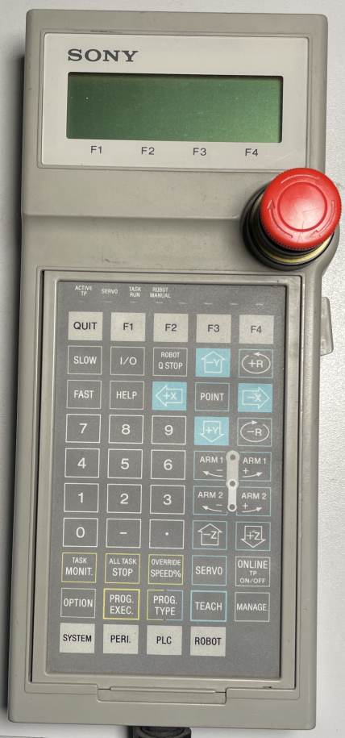

# Teach pendant in the emulator: menu walkthrough (2026-11-09)

What the real CPU firmware (`ROM1-C.bin`) and the real pendant firmware (`IC6`, Z180) show on
the emulated 20×4 LCD, with the EEPROM still blank. The screens are read back from the LCD
model through CPU I/O `0xFA/0xFB` and converted to text by a script: half-width katakana
are decoded as JIS X 0201, and the pendant's custom glyphs are drawn as `│` (separator
above the F-keys), `▶` (cursor) and `↑↓` (more lines). Keys are pressed through CPU I/O
`0xF8/0xF9` (key matrix model).



Tooling: `emu/tools/tp/` — a Lua script (`-autoboot_script`) polls a command file
(`key col rows ms`, `raw col rows`, `wait ms`, `dump`, `peek`) inside a running Docker
container, so the emulator can be driven step by step.

## 1. Key matrix → key code → key

The pendant scans a 7×8 matrix (column = CPU I/O `0xF8`, row bit = `0xF9`); its table at
`0x1259` turns a position into the key code it sends in reply to commands `10`/`11`.
Identified by pressing each position and watching the screen:

| Matrix (col,row) | Code | Key |
|---|---|---|
| c0r7 | `01` | QUIT |
| c1r7 / c2r7 / c3r7 / c4r7 | `02`–`05` | F1 / F2 / F3 / F4 |
| c0r6 | `06` | I/O |
| c1r6 | `07` | ROBOT Q STOP |
| c2r6 | `08` | −Y (also cursor **up**) |
| c0r4 | `10` | +Y (also cursor **down**) |
| c1r5 | `0C` | POINT |
| c5r6 | `0A` | HELP |
| c0r0 | `27` | PROG. TYPE (type list) |
| c0r1 | `21` | TASK MONIT. |
| c1r1 / c3r0 / c5r1 / c5r2 | `22` / `2A` / `26` / `20` | task keys (PROG. EXEC., ALL TASK STOP, …; "no program" messages) |
| c2r0 | `29` | MANAGE |
| c3r1 | `24` | ONLINE TP ON/OFF |
| c4r0 | `2B` | PERI. |
| c5r0 | `2C` | PLC |
| c0r3, c0r5, c1r4, c2r5, c3r2, c3r6, c4r2, c4r3, c5r3, c5r4 (+ c2r6, c0r4) | `15 0B 11 0D 1E 09 1F 19 1A 14` (+`08 10`) | the 12 jog keys (±X ±Y ±Z ±R, ARM1±, ARM2±): "Cannot move robot when servo OFF" |
| **c4r6** | `30` (not reported as a key) | **modifier**, probably **SYSTEM**: hold it + MANAGE → maintenance SETTING menu |
| c6r1 / c6r2 | bits of `[0x8015]` | **key-sheet sense**: set = sheet flipped = **English** display |

Not identified yet: digits, `-`, `.`, SLOW, FAST, OVERRIDE, SERVO, TEACH, ROBOT, OPTION.

## 2. Boot with a blank EEPROM (Japanese sheet)

The controller stops with **E050 "controller parameter error", line 100 (MODEL)**:

```
┌────────────────────┐
│====== ｴﾗｰ !! ======│
│ERR50   --- 00100   │
│ｺﾝﾄﾛｰﾗ ﾊﾟﾗﾒｰﾀ ｴﾗｰ MO│
│               │ ﾇｹﾙ│
└────────────────────┘
```
HELP → "English/Japanese switch" explains that the language follows the key sheet:
*"Turn the key sheet over to get the English display."*

```
┌────────────────────┐
│ﾍﾙﾌﾟ                │
│▶ｴｲｺﾞ/ﾆﾎﾝｺﾞ ｷﾘｶｴ    │
│ ｴﾗｰﾊｯｾｲ ｼﾞﾃｲｼ ﾌﾗｸﾞ │
│               │ｾﾝﾀｸ│
└────────────────────┘
```
```
┌────────────────────┐
│ ｴｲｺﾞ/ﾆﾎﾝｺﾞ ｷﾘｶｴ    │
│ｷｰ ｼｰﾄ ｦ ｳﾗｶﾞｴｽ ﾄ   │
│  ｴｲｺﾞ ﾋｮｳｼﾞ ﾆ ﾅﾘﾏｽ｡│
│               │ ﾇｹﾙ│
└────────────────────┘
```
## 3. The same in English (sheet-sense bit held)

Boot: E050 line 100. The header blinks.

```
┌────────────────────┐
│=====          =====│
│ERR50   --- 00100   │
│C/R parameter error │
│               │QUIT│
└────────────────────┘
```
F4 (QUIT) closes the error: teach screen, robot R1, current position.

```
┌────────────────────┐
│TECH R1         here│
│ X   0.000 Z   0.000│
│ Y   0.000 R   0.000│
│SETING│       │BRAKE│
└────────────────────┘
```
MANAGE: the user management menu (HOME RETURN, CONSTANT, TASK LIST, TYPE LIST, PC CARD, DIAGNOSIS, ERR HISTORY, TPWRITE monitor, CLOCK…).

```
┌────────────────────┐
│MANAGEMENT          │
│▶HOME RETURN        │
│ CONSTANT           │
│             │SELECT│
└────────────────────┘
```
CONSTANT → only SYSTEM LIMIT and SYSTEM OFFSET (the user constants of the manual).

```
┌────────────────────┐
│MANAGEMENT        ↑↓│
│▶SYSTEM LIMIT       │
│ SYSTEM OFFSET      │
│             │SELECT│
└────────────────────┘
```
**Hold c4r6 (SYSTEM?) and press MANAGE**: the maintenance **SETTING** menu, CONTROLR / ROBOT.

```
┌────────────────────┐
│SETTING             │
│▶CONTROLR           │
│ ROBOT              │
│             │SELECT│
└────────────────────┘
```
SETTING → CONTROLR: the controller fields that E050 checks. All empty on the blank EEPROM.

```
┌────────────────────┐
│SETTING CONTROLR  ↑↓│
│▶SERIAL No.:        │
│ MODEL: SRX-        │
│                    │
└────────────────────┘
```
Scrolling down CONTROLR shows the rest of the list:

```
PLC LINE MAX.  :535
SAFETYSW OPTION:YES
SV FREE OPTION :YES
CAST SPEC.     :YES
EXTERNAL ONLINE:YES
SMART OPTION   :YES
D-arm OPTION   :YES
BRAKE AXIS         
```

## 4. Status and next steps

- **How the manual says values are entered** (`books/Sony+SRX+Scara+robot.pdf`, Operation Guide
  §4-7 "Direct Writing" and the key descriptions in §1-5…1-8):
  1. Select the item with the cursor and press the F-key **CHG**; the input area appears on line 3.
  2. Enter the value with `0–9`, `.`, `–`, or scroll each character with ↑/↓ and move on with
     →. Letters and HEX digits are entered by scrolling.
  3. **F1 WRITE** saves; **F4 CANCEL** or **QUIT** leaves without writing.

  The arrows are the ±X/±Y keys, and they act as a cursor only while the ROBOT MANUAL LED is
  off. In CONTROLR (2026-11-09), ↑/↓ only scroll the list. None of the ±X keys, the other jog
  keys, F1–F4 or SYSTEM+F1–F4 opened the input, and the line 4 F-key labels stay empty.

- **Fixed on the way:** the pendant stopped answering after ~10 s, so the keys were dead. The
  cause was a MAME Z180 ASCI bug (the RX interrupt was edge-like). Fixed by
  `emu/patches/0001-z180asci-rdrf-level-irq.patch`.
- **Editing not reached yet.** In CONTROLR, none of the keys tried so far opens the input. The
  screen handler (`0x9460C`, screen `0x82`) passes key events to a character editor
  `0x9F69C`. That editor handles an 8-character field with position 3 skipped (the
  `C61-1039` serial format): events `0x18/0x2E/0x2F` enter a character, `0x3A/0x6C` and
  `0x42/0x74` step it, `0x3D/0x6F` and `0x71` move the cursor, and event `2` validates and
  saves (`0xAA6C`, then screen `0x6E`). The mapping from key code to event is the next thing
  to decode.
- The ROBOT branch holds ROBOT KIND & AXES, REDUCTION RATIO, MV LIMIT, ENCODER P, Arrival P,
  INTERFERE, CNTR DIR, SERVO PARA, HOME PARA, ARM LENGTH, HOME OFF, ACC/QM/QT para, PAYLOAD,
  VIB_CTRL and SLOT/AXIS (name function `0x68B6C`, menu table RAM `0x1490`).

## 5. Entering parameters: what works (2026-11-09)

**Modifier keys.** The pendant adds an offset to a key code while one of four modifier keys is
held (`0x8073`, enabled by the CPU through command `23`): c5r7 (`31`) **+0x32**, c4r6 (`30`)
**+0x64**, c3r5 (`2F`) +0x96, c2r4 (`2E`) +0xC8. These are the shift keys (SLOW/FAST class).
The CPU (`0xBA464`) passes the codes through unchanged into `ctx+0x13EE`; the TP context is at
RAM `0x78598` (screen id `+0x1428`, language `+5`).

**Edit mode.** In SETTING (screen `0x80`), F4 SELECT (event `05`) opens a list read-only.
**F4 with c4r6 held** (event `0x69`) opens it with editing enabled (`ctx+0x17EE = 1`; F4 and
c4r6 share matrix column 4, so press both rows at once). The list then shows **CHANGE** on
F1. After that the flow is the manual's: F1 CHANGE → input on line 3 → c2r6 / c0r4 step the
character, c0r5 / c2r5 move the cursor ← / → → **F1 WRITE**, F4 CANCEL.
`0x7A70C` also requires `[0x4A20]` (online state) = 0.

CONTROLR, entered and written to the EEPROM:

```
┌────────────────────┐   ┌────────────────────┐   ┌────────────────────┐
│SETTING CONTROLR←~↑↓│   │SETTING CONTROLR  ↑↓│   │SETTING CONTROLR  ↑↓│
│ SERIAL No.:        │   │▶MODEL: SRX-611     │   │ SAFETY SPEC :      │
│           ▶C61-1039│   │ DEF ROBOT NUM    : │   │             ▶NORMAL│
│WRITE│       │CANCEL│   │CHANGE│             │   │WRITE│       │CANCEL│
└────────────────────┘   └────────────────────┘   └────────────────────┘
```

| Field | Value entered | EEPROM offset |
|---|---|---|
| SERIAL No. (controller) | `C61-1039` | `0x04` and `0x20` |
| MODEL | `611` (→ "SRX-611") | `0x10` |
| DEF ROBOT NUM | `1` | `0x2C` |
| SAFETY SPEC | `NORMAL` (choices NORMAL / RIA / VDE; the unit's real setting is unknown) | — |

After these writes, the boot no longer stops on the E050 screen, but ERR HISTORY still holds
one `E50`. SETTING → ROBOT R1 lists 17 items: ROBOT KIND & AXES, SERVO PARA, HOME PARA, ARM
LENGTH, HOME OFF, MV LIMIT, REDUCTION RATIO, ENCODR P, ArrivalP, INTRFERE, CNTR DIR, ACC / QM /
QT para, PAYLOAD, VIB_CTRL, SLOT/AXIS. **ROBOT KIND** offers `SCARA 4 XYZR` / `EARTH 4 XYZR`
(strings at RAM `0xA2D8`). The edit field opens empty, and so far no key steps it.

Tool: `tpctl.lua` command `type <field> <cursor> <text>` (closed-loop typing inside the
emulator; editor buffer `ctx+0x16A6` = `0x79C3E`, cursor `ctx+0x17A6` = `0x79D3E`).
EEPROM is only saved on a clean MAME exit (`quit`), not on `docker rm -f`.
